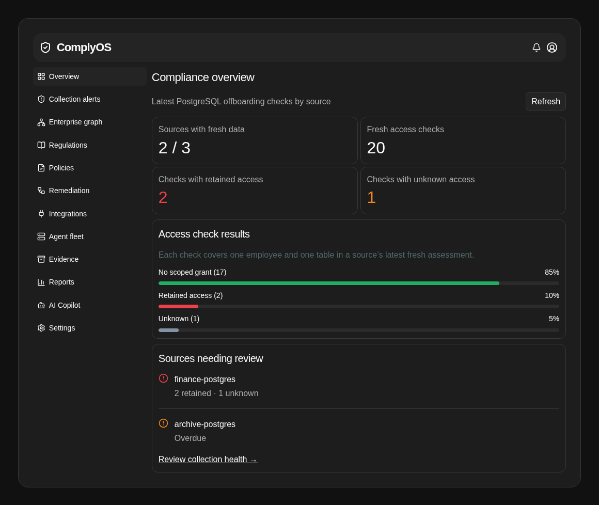

# ComplyOS

ComplyOS helps security teams check who still has permission to read sensitive PostgreSQL tables. For example, when an employee leaves, their old database role may still inherit read access through a group. ComplyOS shows the grant and the evidence behind it so an administrator can remove it and check again.



*The running dashboard with illustrative collection data. A new installation shows an empty inventory until its first collection.*

## Start locally

Install Git, Docker with Compose and OpenSSL. On a new installation, clone the repository and create a private file containing separate random credentials.

```sh
git clone https://github.com/knight099/ComplianceAgent.git
cd ComplianceAgent
(umask 077; set -C; for key in POSTGRES_PASSWORD APP_DB_PASSWORD WORKER_DB_PASSWORD OPERATOR_PASSWORD RELAY_TOKEN; do
  echo "$key=$(openssl rand -hex 32)"
done > .env)
docker compose up --build -d
docker compose ps -a
```

Open the [dashboard](http://localhost:3000). When prompted, sign in as `operator` with the `OPERATOR_PASSWORD` in your local `.env`. Keep this file for later starts. The `migrate` service exits successfully after preparing the database. To troubleshoot startup, run `docker compose logs migrate app db`.

To see your first results, follow the [read-only collection instructions](docs/operator-guide.md#run-a-read-only-collection). Stop the local services with `docker compose down`. Their named volumes retain the data.

## Enterprise walkthrough: from login to a verified finding

Use this sequence for a read-only pilot. The example follows one question from the company's access procedure through to evidence: **can an employee who moved from Lending to Marketing still read customer KYC records?**

1. **Deploy and sign in.** IT runs the [local setup](#start-locally) for an initial evaluation. For a team pilot, create the organization, issue a source-bound relay credential and assign reviewers. Give the analyst role to operators who need AI summaries. For enterprise sign-in, configure the identity provider and login gateway. Sign in to **Operations** and confirm the expected organization has access to its assessments. An empty inventory is normal before the first upload. [Organization setup](docs/operator-guide.md#organization-membership) · [Enterprise login](docs/operator-guide.md#use-an-enterprise-identity-provider-for-operator-apis)

2. **Connect the systems in scope.** For the KYC check, place the relay on a host that can reach the source database. From the repository root on that host, install dependencies with Node.js 24 and `npm ci`. Set `SOURCE_DATABASE_URL` to a read-only PostgreSQL connection, `CONTROL_URL` to the ComplyOS server and `RELAY_TOKEN` to the credential for that source. Add Entra if you need employee-ID corroboration or Saviynt if you need approval history. For a laptop audit, use Intune and the issued-laptop inventory. IT can install the endpoint collector for local OS evidence. [Connection options and commands](#enterprise-connections)

3. **Prepare the compliance directory.** Use a restricted folder on the relay host or your existing document repository. For example, keep the approved SOP under `sops/`, regulatory references under `regulations/`, current HR and asset inputs under `inputs/`, and dated outputs under `reports/`. Compliance staff record the official source, clause, effective version, applicability decision and reviewer for each regulation. This directory is maintained by your team. ComplyOS reads files explicitly supplied to its commands; automatic regulatory ingestion and applicability review are planned.

4. **Turn the SOP into a check.** The data owner translates “only Lending staff may read customer KYC” into a versioned `policy.json`. Include the SOP section, reviewer, source name, table, classification, allowed business roles and any approved exceptions with expiry dates. In `hr-scope.json`, supply the HR export time, current business role and mapped PostgreSQL role for each employee. Use the same source name and table in both files. [Copyable policy example](docs/operator-guide.md#review-access-against-a-company-sop) · [HR input format](docs/operator-guide.md#run-a-read-only-collection)

5. **Agree on the audit checklist.** For this control, check whether the HR record is current, the database role maps to one employee, a direct or inherited grant permits reading the table, and a valid exception covers the grant. Agree who will investigate missing evidence. An analyst can configure an approved model in **AI Copilot** now. Its current **Generate summary** action becomes useful after collection, when it can explain offboarding count ranges and freshness. The team prepares the checklist in the current pilot. [Model setup and privacy](docs/operator-guide.md#connect-your-own-model)

6. **Run each configured collection.** On the relay, generate the SOP report and upload it using the commands below. Run the offboarding assessment if that control is also in scope. Intune produces its own JSON report, installed endpoint collectors run hourly, and scanner imports produce evidence receipts. Start or schedule each applicable collector using its documented entry point. Record which source succeeded, failed or was outside scope. [Laptop audit](docs/laptop-audit.md#run-the-intune-audit) · [Collection health](docs/read-only-pilot.md#monitor-collection-health)

   ```sh
   # From the repository root, with the relay environment from step 2.
   # Replace /secure/compliance with the directory prepared by your team.
   umask 077
   audit_dir=/secure/compliance
   mkdir -p "$audit_dir/reports"
   run_dir=$(mktemp -d "$audit_dir/reports/kyc-review.XXXXXXXX") || exit 1
   report="$run_dir/review.json"
   node relay/access-report.mjs "$audit_dir/sops/policy.json" "$audit_dir/inputs/hr-scope.json" > "$report" &&
     curl --fail-with-body -H "Authorization: Bearer $RELAY_TOKEN" \
       -H 'Content-Type: application/json' --data-binary "@$report" \
       "$CONTROL_URL/api/v1/access-reviews"

   # Separate offboarding assessment for terminated employees in the HR scope.
   node relay/run.mjs "$audit_dir/inputs/hr-scope.json"
   ```

7. **Review the report.** Save the upload receipt. In **Operations → Personal-data access reviews**, open the assessment and expand the employee/table row. Compare expected access with the observed grant, its evidence and any exception. For a local review, open the generated JSON file in **Reports**. If the Marketing employee still has read access, the result can be `EXCESS_ACCESS`. If the HR evidence is stale, the result is `INSUFFICIENT_EVIDENCE`; collect fresh evidence before drawing a conclusion. Review the Intune report and device receipts separately for laptop controls. [Report review and comparison](docs/operator-guide.md#save-a-personal-data-review-in-operations)

8. **Correct access and verify.** The reviewer identifies the grant path and hands the finding to the database owner. The owner follows the company's change process to remove the obsolete grant or document an approved exception. Run step 6 again and compare the earlier and later assessments in Operations. Close the finding only when fresh evidence covers the same employee and table and supports the expected access. Today's relay and endpoint agents collect evidence; the administrator performs the change. [Pilot verification procedure](docs/read-only-pilot.md#compare-collection-history)

### Planned automation

The target workflow starts with a compliance lead adding SOPs, regulations and the systems in scope to an in-app compliance directory. The LLM proposes a checklist that cites the relevant clauses and names the evidence needed for each check. A reviewer approves the scope and checklist before ComplyOS schedules read-only audits across the selected connections.

The planned consolidated report will show findings, supporting evidence and coverage gaps. A reviewer can then assign a manual change or authorize a specific agent operation after reviewing its target and impact. Independent collection will verify the result and retain the before-and-after evidence. These capabilities are tracked in the [enterprise delivery plan](docs/implementation-plan.md#enterprise-access-and-privacy-delivery-sequence).

## Enterprise connections

### Laptop and security tools

| Category | Tools | How to connect today |
|---|---|---|
| Device management (MDM / UEM) | Microsoft Intune, Jamf, Workspace ONE | Use the read-only Intune audit below. Native Jamf and Workspace ONE connectors are planned. |
| Identity management | Microsoft Entra ID, Active Directory, Okta | For Entra employee matching, supply a Microsoft Graph token in `ENTRA_ACCESS_TOKEN` with permission to read users and their employee IDs, then add `--entra` to the HR collection command. Native on-premises AD and Okta inventory connectors are planned. [Entra setup](docs/operator-guide.md#collect-from-hr-csv-and-entra-id) |
| Endpoint detection and response (EDR) | CrowdStrike, Microsoft Defender for Endpoint, SentinelOne | Native connectors for endpoint sensor health and detections are planned. |
| Data loss prevention (DLP) | Microsoft Purview, Forcepoint | Native connectors for DLP policy assignments and events are planned. |
| Remote management | Microsoft Configuration Manager, ManageEngine, Tanium | IT can distribute the collector scripts through its existing deployment process. Native inventory and remote-action connectors are planned. |
| VPN / Zero Trust | Zscaler, GlobalProtect, Netskope | Native connectors for device posture and network access decisions are planned. |
| IT asset management | ServiceNow, Lansweeper | Export the issued laptops in scope and convert the export to the dated inventory JSON used below. Native APIs are planned. [Inventory file format](docs/laptop-audit.md#run-the-intune-audit) |
| Security monitoring (SIEM) | Splunk, Microsoft Sentinel | To forward collection-health alerts, configure `ALERT_WEBHOOK_URL` and `ALERT_WEBHOOK_SECRET` on the monitor. Your receiver must verify the signature and forward the event to your SIEM. Native Splunk and Sentinel connectors are planned. [Webhook setup](docs/read-only-pilot.md#deliver-transitions-to-an-approved-webhook) |

**Run an Intune laptop audit.** On the relay host, use Node.js 24 and supply a Microsoft Graph token in `INTUNE_ACCESS_TOKEN` with the read-only permission `DeviceManagementManagedDevices.Read.All`. Prepare an inventory with the export time, each issued laptop’s asset ID and its Entra device ID where known. From the repository root, run:

```sh
umask 077
node relay/laptop-audit.mjs /secure/issued-laptops.json > /secure/intune-review.json
```

Open the output JSON to review encryption, stale check-ins, missing matches and ambiguous identities. This check runs centrally. The connector has passed fixture tests; confirm its visible scope in your licensed tenant before relying on coverage. [Intune pilot guide](docs/laptop-audit.md#run-the-intune-audit)

**Install the IT collector for local evidence.** Enroll each laptop on the control plane with its own device ID and organization, for example `docker compose exec app node scripts/evidence.mjs enroll LAPTOP-104 payments`. Deliver only that device’s generated JSON through IT’s provisioning channel. For automatic uploads, set its `url` to your HTTPS endpoint ending in `/api/device`.

| Platform | Install under the intended IT-managed account | Evidence collected hourly |
|---|---|---|
| Windows | From the directory containing both collector PowerShell scripts, run `.\install-windows.ps1 -Config C:\Secure\device.json`. | Local Administrators membership and BitLocker protection on the OS volume |
| Linux | From the repository root, run `sh collectors/install-linux.sh /secure/device.json` in a systemd user session. | Local `sudo` and `wheel` membership |

Check the first signed bundle or upload receipt for the enrolled device. A macOS collector and machine-wide signed packages are planned. [Enrollment, verification and uninstall](docs/laptop-audit.md#install-the-endpoint-collector)

### Access reviews and other integrations

| Connection | How to connect today |
|---|---|
| HR and PostgreSQL | On the relay host, set `SOURCE_DATABASE_URL` to the read-only source connection and supply `CONTROL_URL` and `RELAY_TOKEN` for upload. Run `node relay/run.mjs /secure/hr-scope.json`, or supply an HR CSV followed by its scope JSON. Open **Operations** after the relay acknowledges the upload. [HR and database setup](docs/operator-guide.md#run-a-read-only-collection) |
| Saviynt | Create a read-only Analytics control, set `SAVIYNT_CONFIG` to the local mapping configuration and supply `SAVIYNT_TOKEN`. Run `node relay/access-report.mjs policy.json /secure/hr-scope.json` to include matching governance records in the report. The reader is fixture-tested; live tenant qualification is pending. [Required fields and upload instructions](docs/operator-guide.md#compare-saviynt-approvals-with-observed-access) |
| AWS IAM and GitHub | On the evidence host, configure ComplyOS database access and authenticate the relevant CLI. For sandbox IAM group membership, set `SANDBOX_ACCOUNT` and `SANDBOX_USER`, then run `node scripts/evidence.mjs aws`. For default-branch review settings, run `node scripts/evidence.mjs github OWNER/REPO` with permission to read branch protection. |
| Trivy and Prowler | On the evidence host, import an existing JSON scan with `node scripts/evidence.mjs trivy /secure/trivy.json` or `node scripts/evidence.mjs prowler /secure/prowler.json`. The evidence commands print a receipt ID. |
| AI model | Configure approved endpoints in `AI_ENDPOINTS` and model IDs in `AI_MODELS` on the app. In **AI Copilot**, select the provider and model, enter the key if required, and choose **Test connection**. [Model setup](docs/operator-guide.md#connect-your-own-model) |
| Enterprise operator sign-in | Configure the issuer, API audience, signing-key URL and operator memberships in `OIDC_CONFIG_FILE`, set `AUTH_MODE=oidc` and recreate the app. Browser sign-in also requires a configured login gateway. [OIDC and gateway setup](docs/operator-guide.md#use-an-enterprise-identity-provider-for-operator-apis) |

## Guides

- [Audit laptop encryption, check vendor coverage and install the IT collector](docs/laptop-audit.md)
- [Run a pilot and verify an access change](docs/read-only-pilot.md)
- [Check personal-data access against company policy](docs/operator-guide.md#review-access-against-a-company-sop)
- [Run the personal-data access rule with Open Policy Agent](docs/operator-guide.md#evaluate-an-access-review-with-open-policy-agent)
- [Approve an effective-dated policy revision and replay a stored review](docs/operator-guide.md#approve-a-policy-revision-and-replay-a-review)
- [Compare Saviynt governance records with database access](docs/operator-guide.md#compare-saviynt-approvals-with-observed-access)
- [Connect your own AI model](docs/operator-guide.md#connect-your-own-model)
- [Configure enterprise operator API authentication](docs/operator-guide.md#use-an-enterprise-identity-provider-for-operator-apis)
- [Operator guide, credentials and troubleshooting](docs/operator-guide.md)
- [System architecture](docs/complyos-2-system-design.md) · [Implementation checklist](docs/architecture-checklist.md)
