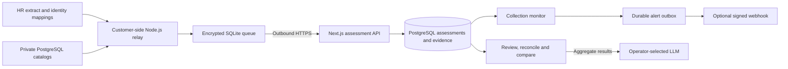
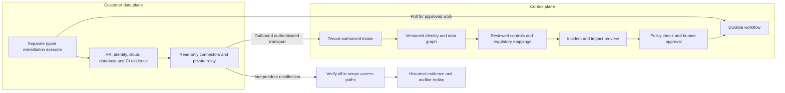

# ComplyOS

ComplyOS checks whether terminated employees retain PostgreSQL read privileges. A customer-side relay correlates an HR extract with explicitly mapped database roles and sends scoped observations to a private control plane. The overview at `/` presents the illustrative enterprise dashboard. The operator workspace at `/operations` opens with an empty inventory and shows the latest assessment for each configured source. Open Compare assessments to inspect changes between two collections.

[Dashboard design system](docs/design-system.md)

## Enterprise architecture

The product goal is continuous control assurance. For a given person and dataset, a reviewer should be able to trace each observed access path to evidence, compare it with an approved policy, and establish what a later collection verified. The current release delivers the read-only PostgreSQL offboarding workflow on `develop/enterprise-core`.

**Running today**



**Enterprise target**



| Area | Implemented | Enterprise milestone |
|---|---|---|
| Identity and access | Explicit HR-to-role mapping, scoped PostgreSQL privilege checks and alternative role paths | Persistent cross-system graph with provenance and tenant isolation |
| Private collection | Outbound relay, encrypted retries, source-bound credentials, signed Windows/Linux evidence bundles | Connector contracts, relay certificates, proxy support and managed fleet |
| Review and operations | Named reviewer/analyst roles, assessment history, baseline reconciliation, freshness, alerts, webhook retry and delivery status | OIDC, audit exports, protected retention and recovery testing |
| Policy and AI | Deterministic offboarding rule and optional bring-your-own-model summaries | Reviewed SOP and regulatory packs, cited investigation and model evaluation |
| Remediation | Independently compare observations before and after an administrator changes access | Approval bound to exact parameters, crash-safe execution, reconciliation and fresh verification |

## Enterprise engineering roadmap

The [ComplyOS 2.0 system design](docs/complyos-2-system-design.md) defines the target for a BFSI pilot. V1 connects HR, Entra, AWS, PostgreSQL and GitHub to explain offboarding and excessive access to sensitive data. Reviewed DPDP and internal controls, a private relay, an evidence-grounded investigator, approved remediation and historical replay complete the proposed release.

| Phase | Estimated weeks | Delivery milestone |
|---|---|---|
| Core platform | 1–4 | TypeScript contracts, Fastify, PostgreSQL migrations and tenant-scoped OIDC authorization |
| Enterprise graph | 4–7 | Temporal relationships, reviewed identity mappings and evidence-backed access paths |
| Collection infrastructure | 6–12 | Five read-only connectors and an enrolled Go relay with offline delivery |
| Compliance detection | 10–13 | Versioned OPA policies, applicability, exceptions, coverage and correlated incidents |
| Safe remediation | 13–17 | Typed actions, human approval, Temporal recovery and independent verification |
| Evidence and intelligence | 15–21 | Signed evidence, historical replay, reviewed regulatory mappings and cited AI investigation |
| Enterprise pilot | 21–24 | Isolation, recovery and load tests followed by an authorized read-only deployment |

[Delivery dependencies, acceptance gates and next build sequence](docs/implementation-plan.md)

**Implemented graph increment:** the PostgreSQL relay now uses a typed read-only connector contract. New and legacy observations feed a snapshot graph of mapped identities, roles and resources; the dashboard reads table-grant paths from its evidence-linked edges. The migration backfills existing assessments and preserves missing historical path evidence. Each deployment currently uses the `installation` organization namespace.

**Next engineering increment:** add an HR CSV adapter with explicit column mapping, identity ambiguity handling and parity tests against the existing JSON input. Then validate the connector contract with an independent identity source before expanding cross-system joins.

[Architecture, module boundaries and implementation sequence](docs/architecture.md) · [Read-only pilot runbook](docs/read-only-pilot.md)

## Start the control plane

Use Node 24 and PostgreSQL 16 or newer. Set unique secrets for `OPERATOR_PASSWORD`, `RELAY_TOKEN` and a URL-safe `POSTGRES_PASSWORD` in the shell, then run `docker compose up --build`. The service binds to localhost:3000. Open the dashboard and sign in as `operator`. Publish the relay ingestion route through a TLS gateway when the relay runs on another host.

For an existing database, set `DATABASE_URL`, `OPERATOR_PASSWORD` and `RELAY_TOKEN`. Run `npm ci`, `node scripts/migrate.mjs`, `npm run build` and `npm start`. The additive migration creates assessment, result and evidence tables. Existing workspace documents are left intact and are excluded from assurance results.

## Run a read-only collection

On the customer-side host, install Node 24 and run `npm ci`. Set `SOURCE_DATABASE_URL` to a read-only PostgreSQL connection, `CONTROL_URL` to the HTTPS control plane and `RELAY_TOKEN` to its ingestion credential. Supply an HR extract and reviewed identity mappings in this JSON shape:

```json
{
  "source": "payments-primary",
  "hrRevision": "hr-export-2026-11-24-01",
  "hrObserved": "2026-11-24T09:00:00Z",
  "resources": [["customer", "identity_records"]],
  "employees": [{"id":"employee-105","status":"terminated","role":"analyst_105"}]
}
```

Run `node relay/run.mjs /secure/path/hr-scope.json`. Use the actual extract timestamp. Include active employees in the mapping so shared-role ambiguity is visible. Use a unique source name per database and scope. Keep the HR extract, connection strings and shared secrets outside version control.

### Recover interrupted uploads

Each collection commits its assessment to an encrypted local SQLite queue before uploading. If the service is unavailable or returns an invalid receipt, the relay exits with an error and retains the assessment. The next collection retries pending reports for the same control-plane origin. To retry independently of collection, run `node relay/run.mjs --flush` with the original control URL, relay token and spool directory. Schedule this command with the host service manager for unattended retries.

Set `RELAY_SPOOL_DIR` to persistent storage accessible only to the relay service account. Its default is `.data/relay` relative to the working directory. Preserve both the database and the adjacent 0600 encryption key across restarts. A local administrator with both can decrypt queued data. Reports retain their original IDs and collection times across delivery attempts; the control plane deduplicates repeated submissions by ID.

## Reading an assessment

* **RETAINED** indicates a PostgreSQL role with SELECT privilege on at least one column, directly, through inheritance or through an available SET ROLE. Evidence identifies the mapped employee, accessible roles, applicable table ACL grantees, resource, HR revision, policy and collection time.
* **NO_SCOPED_GRANT** indicates a negative privilege check on the specified table. The result covers database privileges. Actual login, network access, row-level policies, delegated functions, views and application access require separate evidence.
* **UNKNOWN** identifies missing or ambiguous mappings, a missing relation or role, stale HR evidence or a collection failure. The dashboard flags assessments older than 24 hours.

The relay queries PostgreSQL catalogs and does not read table contents or modify privileges. This implementation is for one organization per deployment. Separate databases, ingestion credentials and operator credentials are required for independent organizations. OIDC, per-relay PKI and approved remediation are future work.

## Verification

Run `npm test` for signed-bundle checks and a PostgreSQL-backed role membership, revocation and migration test. Run `npm run build` for the application build.

## Connect your own model

Select **AI Copilot** in the overview to open **AI model connection**. Select a provider, enter an exact model ID available to your account, provide the API key when the provider requires one, and select **Test connection**. Select an assessment and **Generate summary** to explain its counts and freshness. Each browser session supplies its own credentials. Reloading or clearing the connection releases the key from application state. Use HTTPS when operating remotely and keep request bodies and authorization headers out of proxy logs.

OpenAI is available by default. To offer a private gateway, Ollama, vLLM or another OpenAI-compatible service, set the following on the **app server** and restart it (recreate the app container for Compose):

```sh
export AI_ENDPOINTS='{"OpenAI":"https://api.openai.com/v1/chat/completions","Internal model":"https://models.example.org/v1/chat/completions"}'
```

Replace the example URL with the full chat-completions endpoint. The provider must accept a model and messages and return text in `choices[0].message.content`. The server uses bearer authentication when a key is supplied. Private keyless models can leave the key blank. Loopback HTTP is supported for local inference; inside a container loopback refers to that container. Endpoints using other protocols or authentication schemes need a compatible gateway. Test calls may incur provider charges.

## Individual operator and relay credentials

For a dedicated organization, set `AUTH_MODE=named` on the app and run the migrations. Recreate the Compose app after changing modes. Named mode authenticates each request against PostgreSQL and disables the shared credentials. Existing deployments default to `shared` for compatibility.

Run these commands on the control-plane host with administrative database access (or prefix each with `docker compose exec app`):

```sh
node scripts/identity.mjs issue operator alice
node scripts/identity.mjs issue relay payments-relay payments-primary
```

Each issue command prints a generated secret once. Deliver it through your secret manager. An operator signs in with the issued name and secret. To remove that operator’s access, run `node scripts/identity.mjs revoke operator alice`. A relay uses its secret as `RELAY_TOKEN` and submits only the source named at issuance. To revoke it, run `node scripts/identity.mjs revoke relay payments-relay`. Revocation applies to subsequent requests. For rotation, issue a distinct name, deploy its credential, verify access, then revoke the previous name. Prior assessments retain their original submitter attribution; assessments predating this feature show “Unrecorded”.

### Operator permissions

In named mode, a **reviewer** can read assessments and an **analyst** can also list model providers, test connections and request AI summaries. To issue a review-only credential, run `node scripts/identity.mjs issue operator alice reviewer`. Change an existing credential with `node scripts/identity.mjs set-role operator alice analyst` or substitute `reviewer`. Changes take effect on the next API request. Existing operator credentials, issuance without a role, and shared operator mode retain analyst access for compatibility.

[Run a read-only pilot and reconcile the results](docs/read-only-pilot.md)

[Configure the collection alert monitor](docs/read-only-pilot.md#automated-collection-alerts)

[Enable signed webhook notifications for collection alerts](docs/read-only-pilot.md#deliver-transitions-to-an-approved-webhook)
