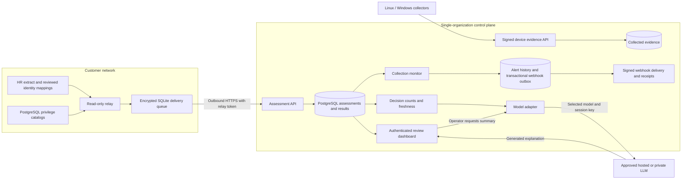
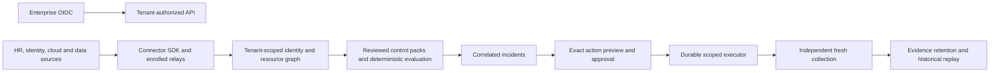
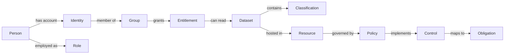

# ComplyOS architecture and module status

## Running system

## Modules and boundaries

| Module | Available today | Evidence or limitation |
|---|---|---|
| HR and database correlation | Stable employee IDs and explicit PostgreSQL role mappings, inherited and switchable roles, bounded table-grant path explanations, table and column SELECT checks | Decision per employee and scoped relation. Missing mappings, stale HR evidence and unavailable sources yield UNKNOWN. |
| Customer relay | Read-only catalog queries, encrypted local queue, destination binding, retry with original ID | Restart, receipt mismatch and repeat delivery covered by tests. One-shot collector and flush commands require external scheduling. |
| Control plane | Authenticated intake, transactional result writes, per-source collection history, source collection health and snapshot comparisons | One organization per installation. Named operators and source-scoped relays support independent revocation; shared credentials remain a compatibility mode. |
| Evidence collection | Signed endpoint bundles and CLI evidence imports | Separate evidence records. These observations do not currently affect the offboarding decision. |
| AI connectivity | Server-side chat-completions adapter, operator-provided model and key, connection test and assessment summary | Optional. Input is restricted to aggregate results and collection time. A summary cannot modify a decision or execute a change. |
| Deployment | Next.js, PostgreSQL, Compose, additive schema migration | Catalog behavior tested using embedded PostgreSQL. Customer infrastructure validation is outstanding. |

## Planned pilot architecture

## First implementation sequence

| Order | Change | Exit criterion |
|---|---|---|
| 1 | Capture the existing authenticated intake and relay output as versioned TypeScript contracts with runtime validation. Define connector capability, observation batch, checkpoint, collection time, provenance and partial-coverage fields. | Contract tests exercise a successful collection, denied catalog read, stale HR extract, retry and an older stored report. |
| 2 | Wrap the PostgreSQL collector behind a read-only connector interface. Keep the Node relay and its queue as the first consumer. | Running the relay against the same input yields the same decisions and provenance. A connector with no action methods can complete collection. |
| 3 | Add entity and relationship projections through additive migrations. Assign the existing installation an explicit organization before backfill. Deduplicate by tenant, source, type and stable external ID. | Replaying a batch produces no duplicate edges. Identical external IDs from two organizations cannot join. Both grant paths point back to their assessment. |
| 4 | Backfill historical assessments and compare projected results with the existing access query. Treat absent historic path evidence as unknown. | Removing one of two paths preserves retained access; stale or missing scope never closes an incident. Switch the first reader only after comparison passes. |
| 5 | Add Entra and HR input adapters, followed by AWS IAM/S3 and GitHub App collection. In parallel, add OIDC and enforce tenant scope in API, storage, queues, exports and model requests. | Connector fixtures cover paging, revoked credentials and partial visibility. Verify live permissions in authorized accounts and run isolation tests before enrolling a second organization in one deployment. |

The first connector and projection are implemented for PostgreSQL. The relay emits `complyos.assessment/v1`; intake normalizes unversioned uploads and rejects unsupported versions before persistence. Historical backfill and ingestion use the same projector. The dashboard reads table paths reconstructed from projected hops; decisions and raw evidence remain available from the original observations. Empty paths do not establish absence of all privileges.

## Domain model and provenance

The control plane currently stores assessments, per-resource results, evidence observations, named identities, alert episodes and deliveries in PostgreSQL. SQLite holds the relay's local retry queue. Migration 007 projects assessed HR-to-account mappings and PostgreSQL table-grant witnesses into typed, snapshot-scoped edges. The entity view keys identifiers by organization, source and kind. Each edge links to its original result. Cross-provider identity resolution and shared-tenant authorization remain planned.

| Planned records | Design contract |
|---|---|
| Tenants, users, roles, connectors, agents and certificates | Tenant-scoped authorization, connector ownership, device identity, expiry and revocation |
| Entities, identity mappings, relationships and observations | Stable external identifiers, reviewed or inferred linkage, source evidence ID, observed time, validity interval, confidence and freshness |
| Policies, immutable policy versions, exceptions, regulatory documents, clauses and control mappings | Applicability, source URL, amendment history, reviewer, effective dates, approved exceptions and evidence requirements |
| Incidents, plans, approvals, executions and verification runs | Correlation key, affected resources, target state, policy version, approval expiry, action fingerprint, idempotency key and independent verification criteria |
| Evidence objects, audit events and transactional outbox | Signed provenance, retention location, content hash, append-only activity and reliable event delivery |

Use tenant-aware composite foreign keys for relationships, row-level security, tenant-scoped uniqueness and traversal indexes. Start with bounded recursive PostgreSQL queries. An edge backed by a grant represents assigned or evaluated permission; observed use requires an access event.

## Collection and deployment modules

| Installation | Current boundary | Target |
|---|---|---|
| Enterprise relay | Node process inside the private network, read-only PostgreSQL catalog queries, encrypted local queue and scoped bearer authentication | Build this before expanding endpoint management. Add local secret references, outbound mTLS, proxy support, signed typed jobs, high availability and isolated write credentials. Evaluate Go packaging against the same connector contract. |
| Endpoint agent | IT-installed Python and PowerShell privilege collectors with per-device HMAC | Shared Go enrollment, signing, scheduler, encrypted spool, resource budgets and signed updates. Add Linux systemd packages, Windows Service/MSI and macOS launchd/notarized package. Collect approved encryption, patch, firewall, lock and privileged-account signals; prefer existing Intune, Jamf or CrowdStrike evidence where available. |
| Agentless cloud | Existing CLI evidence import paths | Delegated short-lived credentials, AWS SDK adapters and explicit coverage for conditions, denials and unsupported policy mechanisms. Expand providers after pilot demand. |
| CI/CD scanner | Repository logging check and scanner evidence import | CI integrations emitting commit-bound dependency, secret and infrastructure findings with redacted evidence. |

Connector SDK operations are connection validation, capability discovery, checkpointed collection and verification. Preview and execute are optional, typed capabilities. P0 includes PostgreSQL, AWS IAM/S3, GitHub App, Entra and HR CSV/webhook. P1 adds Saviynt, Darwinbox, Okta, Jira and Intune. P2 adds Workday, ServiceNow, SailPoint, Snowflake and Kubernetes. Use contract fixtures until an authorized commercial sandbox is available.

## Regulatory intelligence, actions and evidence

1. Ingest an official document or internal SOP as a versioned source. An LLM proposes clause-level obligations and mappings. A specialist records applicability, dates, interpretation and approval before activation.
2. A technical pack declares required evidence, deterministic evaluation, allowed actions and verification criteria. For example, a restricted-data access control may support a reviewed DPDP section 8(5) mapping. Record the legal review separately from the access result.
3. Use five logical AI roles for regulatory extraction, evidence investigation, risk explanation, remediation planning and verification summaries. Ground outputs in authorized evidence, version prompts, and evaluate citation accuracy. The model proposes; policy, authorization and approval determine execution.
4. Start with observe, recommend and human-approved modes. Bind approval to exact operations, risk, affected resources, current-state fingerprint, policy version, approver and expiry. Revalidate before execution. Persist intent first, execute outside the database transaction, record receipts and reconcile uncertain outcomes before retry.
5. Fresh independent observations determine closure across alternative paths. Preserve unknown, stale, not applicable, partially verified and verified outcomes. Regulatory replay should recover the contemporaneous source coverage, policy, decision, approver, operations and closure evidence.
6. Canonicalize and hash evidence, verify source signatures, protect signing keys, and store signed metadata alongside objects under independent retention controls. Test backup restoration and key rotation.

## Technology and repository evolution

Retain Next.js, PostgreSQL, Compose and the current Node tests. Introduce shared TypeScript contracts first. Fastify with Zod/OpenAPI and Drizzle are candidates for an independently deployed modular API when a second consumer or deployment boundary justifies extraction. Keep graph projection, policy evaluation, incident correlation, remediation and verification as logical modules with separate workers where durable execution is needed.

| Concern | Planned choices and adoption point |
|---|---|
| Workflow and transport | Keep transactional outboxes. Evaluate Temporal before production writes; add NATS only for demonstrated event fan-out. |
| Policy and AI | Evaluate OPA/Rego for reviewed control packs and action gates. Add structured model output, approved retrieval and pgvector when a reviewed corpus exists. Keep the existing bring-your-own-model connection. |
| Platform security | Enterprise IdP or Keycloak for OIDC; Vault or cloud secret references; S3-compatible protected evidence storage. Consider SPIRE for workload identity at scale. |
| Deployment and observability | Helm for enterprise clusters, OpenTelemetry with Prometheus/Grafana, CI, dependency and artifact checks, Testcontainers and Playwright. Add Redis only for a measured cache requirement. |
| Reuse | Evaluate Cartography and Cytoscape.js for graph modeling and display; Prowler, Cloud Custodian, osquery, Trivy, Steampipe, Semgrep and Presidio for bounded collection, approved remediation and redaction. Use OSCAL as an interchange reference. Review each tool and bundled rule license before redistribution. |

As modules acquire independent consumers, group dashboard, API, gateway and auditor portal under `apps/`; connector implementations under `connectors/`; reusable contracts, graph, policy, identity, auth and evidence logic under `packages/`; execution processes under `workers/`; and endpoint/relay binaries under `agents/`. Group reviewed packs under `policies/` and deployment assets under `infrastructure/`. Introduce pnpm and Go workspaces with the first extracted packages. These are proposed destinations; today's directory structure and operating commands remain documented in the README.

## Enterprise capability checklist

This tracker uses the enterprise acceptance scope. Items in the middle column have usable components and an outstanding production gate. A blank entry means no completed capability is claimed in that category.

| Workstream | Implemented for current single-organization scope | Partial implementation and remaining gate | Planned |
|---|---|---|---|
| Platform foundation | Additive database migrations | SSO/RBAC has named reviewer and analyst roles; add federation. Secrets management uses local configuration; add managed secret references. | Multi-tenant isolation, versioned public APIs, rate limiting and API access audit logs |
| Core differentiation | Independent scoped PostgreSQL privilege verification | Generic graph has bounded PostgreSQL path evidence; add reusable projections. Identity resolution uses explicit HR mappings; extend to directory identities. Effective permissions cover scoped PostgreSQL reads; extend across connectors. Alert deduplication covers collection health; add access-incident correlation. | Regulatory applicability modeling |
| Agent infrastructure | Encrypted offline relay buffering and retry | Fleet monitoring tracks sources and delivery; add inventory, enrollment and lifecycle administration. Private relay supports PostgreSQL; extend connector hosting and transport identity. | Cross-platform Go endpoint agent, certificate-based enrollment, signed software updates |
| Remediation and evidence | Independent post-change verification for the PostgreSQL scope | Historical comparisons retain assessments and policy versions; extend replay to approvals and execution. Device bundles have HMAC authentication; add independently retained tamper-evident evidence. | Durable remediation workflows, action-level approvals, partial-execution reconciliation |
| Enterprise product | Self-hosted deployment and source health/coverage dashboard | | Integration marketplace, data residency configuration, auditor portal, tested backup and disaster recovery |
| Engineering quality | | Connector behavior, relay failures, webhook retries and model request boundaries have automated tests. Extend to shared connector contracts, representative load/failure injection, and substantive AI output evaluations. | Automated CI/CD, tenant-isolation suite, software supply-chain controls |

## Pilot scope and investment

Extend the existing PostgreSQL offboarding workflow with Entra evidence first. Next validate role transfers retaining KYC access across HR, IGA and AWS, then unapproved privileged access across IAM, Jira and AWS. Later workflows cover public cloud resources containing restricted data and personal identifiers introduced through code or schema changes.

Use the proposed allocation as a planning budget: 30% graph and identity correlation, 25% relay and connectors, 20% remediation and verification, 15% security and evidence, 5% AI and 5% dashboard. Validate differentiation by measuring time to explain a cross-system grant, unexplained paths, evidence coverage and time to verified closure against a data owner's existing review process. Shared hosting, commercial integrations, automated writes and regulatory sign-off each require their own acceptance evidence.

[24-week delivery phases](../README.md#enterprise-engineering-roadmap) · [Authorized pilot workflow](read-only-pilot.md)
