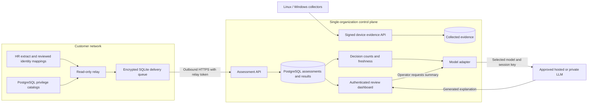
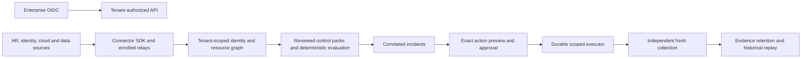

# ComplyOS architecture and module status

## Running system

## Modules and boundaries

| Module | Available today | Evidence or limitation |
|---|---|---|
| HR and database correlation | Stable employee IDs and explicit PostgreSQL role mappings, inherited and switchable roles, bounded table-grant path explanations, table and column SELECT checks | Decision per employee and scoped relation. Missing mappings, stale HR evidence and unavailable sources yield UNKNOWN. |
| Customer relay | Read-only catalog queries, encrypted local queue, destination binding, retry with original ID | Restart, receipt mismatch and repeat delivery covered by tests. One-shot collector and flush commands require external scheduling. |
| Control plane | Authenticated intake, transactional result writes, per-source collection history, source collection health and snapshot comparisons | One organization per installation. Named operators and source-scoped relays support independent revocation; shared credentials remain a compatibility mode. |
| Evidence collection | Signed endpoint bundles and CLI evidence imports | Separate evidence records. These observations do not currently affect the offboarding decision. |
| AI connectivity | Server-side chat-completions adapter, operator-provided model and key, connection test and assessment summary | Optional. Input is restricted to aggregate results and collection time. A summary cannot modify a decision or execute a change. |
| Deployment | Next.js, PostgreSQL, Compose, additive schema migration | Catalog behavior tested using embedded PostgreSQL. Customer infrastructure validation is outstanding. |

## Planned pilot architecture

## Remaining work in dependency order

1. **Pilot identity and isolation.** Add enterprise OIDC and certificate enrollment to the named-identity workflow. Prove isolation with two independent organizations and overlapping external IDs.
2. **Connector SDK and persistent graph.** Normalize observations and identity links, retain validity and provenance, and integrate HR, Entra, PostgreSQL, AWS and GitHub. Demonstrate that a second access path keeps an incident open.
3. **Policy and incident lifecycle.** Version company SOPs, regulatory sources, applicability and reviewer decisions. Correlate repeated observations while retaining unknown or partial coverage.
4. **Approved remediation and verification.** Persist approvals, action receipts, idempotency keys and reconciliation work before external writes. Inject a crash after execution and verify recovery using independent evidence.
5. **Evidence and operations.** Add signed retention, as-of replay, backup/restore verification, webhook delivery monitoring, CI security checks and load testing in a customer-authorized pilot.
6. **AI expansion.** Add reviewed legal-source retrieval, evidence citations, model evaluation, per-user managed credentials and native provider protocols as required. Current interoperability is the chat-completions HTTP contract.
