# **ComplyOS 2.0 — Detailed System Architecture Design**

**Product:** Enterprise Agentic Compliance and Regulatory Control Assurance Platform\
**Architecture:** Hybrid SaaS / Self-hosted, event-driven, agent-based\
**Design objective:** Continuously discover, evaluate, investigate, remediate and verify enterprise compliance violations across organizational systems.

This architecture builds upon your existing [ComplianceAgent repository](https://github.com/knight099/complianceagent?utm_source=chatgpt.com), preserving its policy engine, evidence collection, approval mechanism and historical replay capabilities while removing the scenario-specific limitations.

The target application should be capable of answering six questions for any enterprise:

- What regulations and internal policies apply to us?
- Where are we violating those policies?
- Who has access to sensitive information, and why?
- What is the business and regulatory impact?
- How can the violation be corrected safely?
- Can we prove to an auditor that it was corrected?

# **1. High-level system architecture**

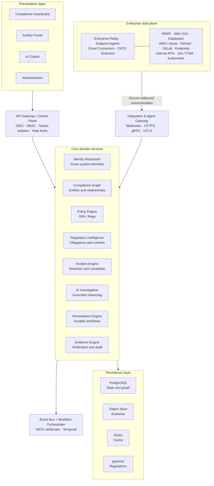

Logical architecture. Domain services can initially run within a modular monolith rather than separate microservices.

The application is divided into two major environments.

| Environment   | Responsibility                                                                       |
| ------------- | ------------------------------------------------------------------------------------ |
| Control plane | Intelligence, policies, workflows, dashboards, incidents and administration          |
| Data plane    | Enterprise discovery, evidence collection, local scanning and authorized remediation |

For highly regulated organizations, both planes can be deployed entirely inside their own infrastructure.

# **2. Complete technology stack**

| Component               | Technology                               |
| ----------------------- | ---------------------------------------- |
| Frontend                | Next.js, TypeScript, React               |
| UI components           | Tailwind CSS, Shadcn UI                  |
| State management        | TanStack Query, Zustand                  |
| Graph visualization     | Cytoscape.js                             |
| Backend                 | Fastify, TypeScript                      |
| API specification       | OpenAPI, Zod                             |
| Agent software          | Go                                       |
| Agent communication     | gRPC, Protobuf, HTTPS                    |
| Primary database        | PostgreSQL                               |
| ORM                     | Drizzle                                  |
| Graph database          | PostgreSQL initially; Neo4j if justified |
| Vector database         | pgvector                                 |
| Cache                   | Redis                                    |
| Event streaming         | NATS JetStream                           |
| Workflow orchestration  | Temporal                                 |
| Policy evaluation       | OPA/Rego                                 |
| AI orchestration        | LangGraph where required                 |
| LLM abstraction         | Vercel AI SDK                            |
| Authentication          | OIDC, SAML via identity broker           |
| Identity provider       | Keycloak / enterprise IdP                |
| Object storage          | AWS S3 / MinIO                           |
| Secrets                 | Vault / AWS Secrets Manager              |
| Observability           | OpenTelemetry                            |
| Metrics                 | Prometheus                               |
| Dashboards              | Grafana                                  |
| Logs                    | Loki                                     |
| Infrastructure          | Terraform                                |
| Container orchestration | Kubernetes, Helm                         |
| CI/CD                   | GitHub Actions                           |
| Testing                 | Vitest, Testcontainers, Playwright       |
| Monorepo                | pnpm workspaces, Go workspace            |

Redis, NATS, Neo4j and Kubernetes do not all need to be introduced immediately. The initial deployment should remain operationally manageable.

# **3. Application domain architecture**

The backend should contain 16 logical modules with clearly defined responsibilities.

01

**Tenant & Identity Service**

Organizations, SSO, users, roles and permissions

02

**Integration Service**

Connector registration, configuration and capabilities

03

**Agent Management Service**

Enrollment, certificates, health and software updates

04

**Collection Service**

Scheduled scans, webhooks and incremental discovery

05

**Normalization Service**

Converts provider-specific records into common observations

06

**Identity Resolution Service**

Matches employee identities across enterprise systems

07

**Compliance Graph Service**

Models enterprise assets, permissions and relationships

08

**Data Classification Service**

Identifies sensitive data and business ownership

09

**Regulatory Intelligence Service**

Regulations, amendments, obligations and applicability

10

**Policy Service**

Versioned controls and deterministic evaluations

11

**Incident Service**

Violation detection, correlation and prioritization

12

**AI Investigation Service**

Evidence-grounded analysis and recommendations

13

**Remediation Service**

Planning, approval, execution and reconciliation

14

**Evidence Service**

Evidence provenance, signatures and retention

15

**Reporting Service**

Management reports, auditor exports and historical replay

16

**Notification Service**

Slack, email, Teams, Jira and escalation workflows

These are domain boundaries, not a requirement to deploy 16 independent servers.

# **4. Enterprise onboarding architecture**

When an enterprise purchases ComplyOS, the onboarding process should discover and establish its compliance monitoring scope.

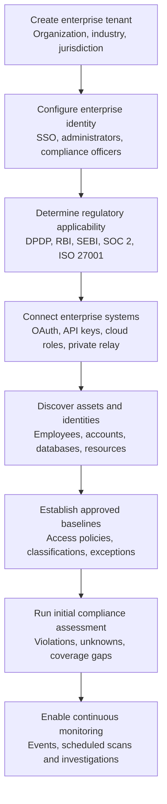

The enterprise should receive an initial assessment that separates actual detected violations from areas where ComplyOS does not yet have sufficient evidence.

# **5. Agent and collector architecture**

ComplyOS should have four distinct collection mechanisms.

## **5.1 Endpoint agent**

The endpoint agent is installed on individual employee laptops, workstations or servers where existing endpoint management integrations cannot supply sufficient evidence.

### **Internal Go agent architecture**

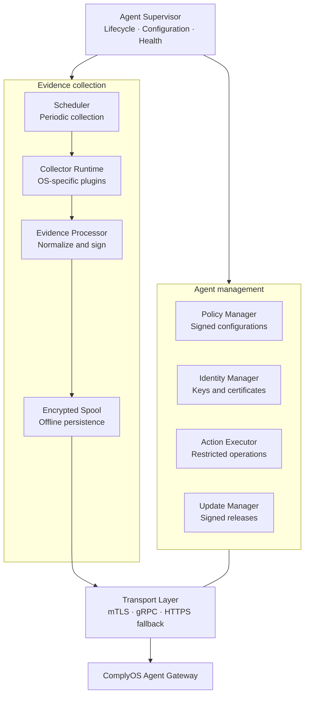

### **Installation methods**

| Platform        | Package    | Execution               |
| --------------- | ---------- | ----------------------- |
| Windows         | Signed MSI | Windows Service         |
| Ubuntu / Debian | DEB        | systemd                 |
| RHEL            | RPM        | systemd                 |
| macOS           | Signed PKG | launchd                 |
| Kubernetes      | Helm       | Deployment or DaemonSet |

### **Proposed agent configuration**

```
agent:
  mode: endpoint
  environment: production

gateway:
  endpoint: https://agents.complyos.example
  transport: grpc
  tls: mutual

collection:
  heartbeat_interval: 60s
  posture_interval: 15m
  full_inventory_interval: 24h

collectors:
  local_accounts: true
  privileged_groups: true
  disk_encryption: true
  patch_status: true
  firewall: true
  endpoint_protection: true

privacy:
  collect_personal_files: false
  collect_browser_history: false
  collect_credentials: false

execution:
  enabled: false

spool:
  encrypted: true
  max_size_mb: 100
```

These intervals are configurable starting defaults, not mandatory enterprise requirements.

### **Agent lifecycle**

```
UNREGISTERED
     ↓
ENROLLING
     ↓
ACTIVE
     ├── DEGRADED
     ├── OFFLINE
     ├── UPDATING
     ├── QUARANTINED
     └── REVOKED
```

Each agent generates its own cryptographic identity. Enrollment tokens are short-lived and tenant-bound. Device certificates are rotated automatically.

A device that stops reporting must become stale or unknown rather than remain compliant indefinitely.

## **5.2 Enterprise relay**

The relay is installed inside a customer VPC, data center or corporate network.

Unlike the endpoint agent, it primarily connects to private enterprise services.

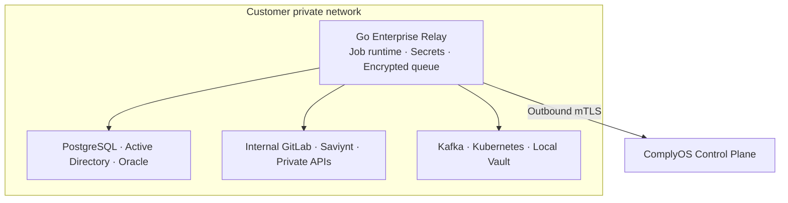

The relay maintains an outbound connection to the control plane. Collection instructions travel through this established connection, and the relay accesses local services using customer-managed credentials.

It should support active-active instances, job leases, retries, corporate HTTP proxies, offline buffering and per-connector concurrency limits.

## **5.3 Agentless cloud integrations**

| Platform         | Authentication                        | Discovery                              |
| ---------------- | ------------------------------------- | -------------------------------------- |
| AWS              | Cross-account IAM role                | IAM, S3, RDS, EC2, CloudTrail, KMS     |
| Azure            | Entra application / workload identity | Resources, RBAC, Key Vault             |
| GCP              | Workload identity federation          | IAM, storage, BigQuery                 |
| GitHub           | GitHub App                            | Repositories, teams, permissions, PRs  |
| Okta             | Scoped OAuth                          | Users, groups, application assignments |
| Microsoft Entra  | Microsoft Graph                       | Users, groups, roles, applications     |
| Intune           | Microsoft Graph                       | Device compliance                      |
| Google Workspace | Approved delegated access             | Accounts, groups, Drive permissions    |

Read-only and remediation credentials must be separated.

## **5.4 CI/CD compliance scanner**

Developer creates pull request

GitHub / GitLab webhook

Scan code and infrastructure changes

Evaluate applicable enterprise policies

Publish evidence and policy findings

Pass, request review or block merge

Use Trivy, Semgrep and infrastructure scanners as collection tools. ComplyOS should correlate their findings with business data classification and approved internal controls.

For example, a database migration adding an Aadhaar field without an approved protection mechanism could trigger a data-protection review.

# **6. Connector SDK architecture**

Every enterprise integration should follow the same lifecycle and contract.

```
interface Connector {
  manifest: ConnectorManifest;

  validateConnection(
    context: ConnectorContext
  ): Promise<ConnectionResult>;

  discoverCapabilities():
    Promise<Capability[]>;

  collect(
    request: CollectionRequest
  ): AsyncIterable<ObservationBatch>;

  verify(
    request: VerificationRequest
  ): Promise<VerificationResult>;

  previewAction?(
    action: ActionRequest
  ): Promise<ActionPreview>;

  executeAction?(
    action: AuthorizedAction
  ): Promise<ActionReceipt>;
}
```

### **Connector manifest**

```
id: aws-iam
version: 1.0.0
provider: aws

capabilities:
  collection:
    - identities
    - groups
    - roles
    - policies
    - permissions

  verification:
    - group_membership
    - scoped_effective_access

  remediation:
    - remove_group_membership

execution_modes:
  - cloud
  - enterprise_relay

authentication:
  type: delegated_role

default_permissions:
  mode: read_only
```

### **Connector execution flow**

```
Scheduler / Webhook
        ↓
Create collection job
        ↓
Resolve connector configuration
        ↓
Acquire job lease
        ↓
Resolve scoped credentials
        ↓
Fetch provider records
        ↓
Normalize observations
        ↓
Persist evidence
        ↓
Publish observation event
        ↓
Save incremental checkpoint
```

Each connector must implement pagination, rate-limit handling, incremental checkpoints, retry policies, timeout limits and explicit coverage reporting.

A connector should never interpret an incomplete API response as proof that a resource or permission no longer exists.

# **7. Data ingestion and event-driven architecture**

Enterprise systems continuously produce changes. ComplyOS should react to those changes without repeatedly scanning the entire organization.

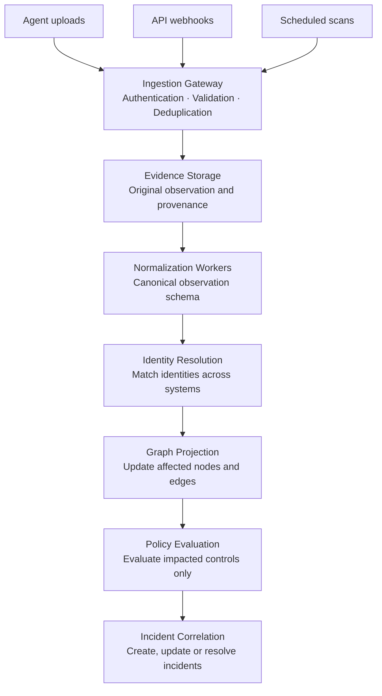

## **Canonical event format**

Use a CloudEvents-compatible event envelope.

```
{
  "specversion": "1.0",
  "id": "evt_001",
  "type": "identity.employee.transferred.v1",
  "source": "/connectors/hrms",
  "subject": "employee/EMP104",
  "time": "2026-11-25T06:30:00Z",
  "tenantid": "tenant_001",
  "correlationid": "corr_001",
  "data": {
    "employee_id": "EMP104",
    "previous_department": "Lending",
    "current_department": "Marketing",
    "effective_at": "2026-11-25T06:30:00Z"
  }
}
```

## **Event topics**

| Topic                    | Consumers                      |
| ------------------------ | ------------------------------ |
| `observation.received`   | Evidence, normalization        |
| `observation.normalized` | Identity resolution            |
| `identity.changed`       | Graph projection               |
| `resource.changed`       | Graph projection               |
| `entitlement.changed`    | Graph projection               |
| `graph.updated`          | Policy evaluation              |
| `policy.violated`        | Incident engine                |
| `incident.created`       | AI investigator, notifications |
| `remediation.approved`   | Workflow orchestrator          |
| `remediation.executed`   | Verification engine            |
| `verification.completed` | Incident, evidence engine      |
| `regulation.updated`     | Regulatory intelligence        |
| `agent.health.changed`   | Agent management               |

Use at-least-once delivery with idempotent consumers. Do not assume the event broker guarantees exactly-once execution of external actions.

The transactional outbox pattern should guarantee that database changes and the intention to publish their corresponding events are committed together.

# **8. Compliance Graph — core intellectual property**

The Compliance Graph is the central intelligence layer of the entire platform.

It connects employees, identities, permissions, business resources, sensitive information, internal controls and regulatory obligations.

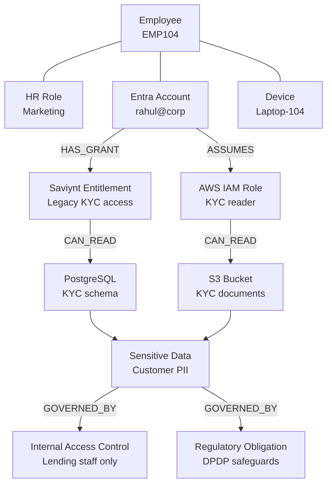

Illustrative graph showing two independent access paths to restricted customer data.

## **8.1 Entity types**

| Category       | Entities                                         |
| -------------- | ------------------------------------------------ |
| Workforce      | Employee, contractor, department, business role  |
| Identity       | User account, service account, workload identity |
| Authorization  | Group, role, permission, entitlement, policy     |
| Infrastructure | Server, cloud resource, container, cluster       |
| Application    | Repository, API, service, SaaS application       |
| Data           | Database, schema, table, column, bucket, dataset |
| Governance     | Regulation, obligation, control, exception       |
| Operations     | Ticket, incident, approval, remediation action   |
| Evidence       | Observation, scan, audit record                  |

## **8.2 Relationship types**

```
EMPLOYED_AS
REPORTS_TO
HAS_ACCOUNT
MEMBER_OF
ASSUMES_ROLE
HAS_ENTITLEMENT
GRANTS_PERMISSION
CAN_READ
CAN_WRITE
CAN_ADMINISTER
OWNS
HOSTED_ON
CONTAINS
CLASSIFIED_AS
PROCESSES
GOVERNED_BY
IMPLEMENTS
MAPS_TO
APPROVED_BY
SUPPORTED_BY_EVIDENCE
```

## **8.3 Temporal graph**

The graph should store historical relationships rather than just current relationships.

For every edge, record:

```
interface Relationship {
  id: string;
  tenantId: string;

  sourceEntityId: string;
  targetEntityId: string;

  type: RelationshipType;

  validFrom: Date;
  validUntil: Date | null;

  observedAt: Date;
  recordedAt: Date;

  evidenceId: string;
  confidence: number;

  attributes: Record<string, unknown>;
}
```

This enables questions such as:

> Which employees had access to customer KYC data on 1 October, and which company policy was active at that time?

Distinguish when an entitlement was effective from when ComplyOS discovered it. Otherwise historical reports may incorrectly imply that the platform knew about a violation earlier than it actually did.

## **8.4 Graph query engine**

The graph service should expose bounded, authorized queries such as:

```
findAccessPaths(identityId, resourceId);

findAffectedResources(identityId);

findResourceOwners(resourceId);

findExcessiveEntitlements(identityId);

findUnapprovedPrivilegePaths(identityId);

findRegulatoryExposure(resourceId);

simulateEntitlementRemoval(entitlementId);
```

Use cycle detection, traversal-depth limits and indexed relationship lookups.

Effective permissions must also account for provider-specific semantics such as explicit denies, conditional policies, resource policies, inherited roles and active sessions. A generic graph path alone cannot prove effective access.

# **9. Cross-system identity resolution engine**

One of the hardest enterprise problems is determining whether accounts in different systems belong to the same employee.

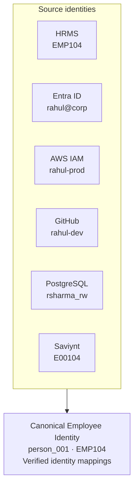

### **Matching strategy**

| Matching evidence               | Reliability                   |
| ------------------------------- | ----------------------------- |
| Verified employee ID            | Very high                     |
| SCIM external identifier        | Very high                     |
| Authoritative directory mapping | High                          |
| Verified corporate email        | High, subject to reassignment |
| Username similarity             | Low                           |
| Name similarity                 | Low                           |

The engine should prioritize authoritative identifiers and verified mappings. Ambiguous identities must be sent for human review.

Never automatically revoke an account based only on a fuzzy name match.

# **10. Regulatory intelligence engine**

This module continuously manages the relationship between external regulations and internal enterprise controls.

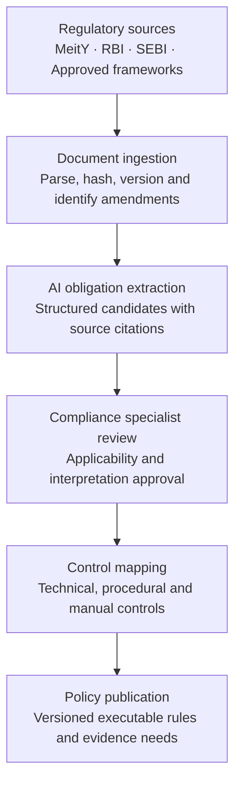

## **Regulatory data hierarchy**

```
Jurisdiction
  └── Regulatory authority
       └── Regulation
            └── Regulation version
                 └── Section / clause
                      └── Obligation
                           └── Internal control
                                └── Technical policy
                                     └── Evidence requirement
```

### **Example regulatory mapping**

```
{
  "framework": "DPDP",
  "clause": "8(5)",
  "obligation": "Reasonable security safeguards",
  "internal_control": "AC-004",
  "technical_policy": "restrict_sensitive_data_access",
  "evaluation_type": "automated",
  "evidence_requirements": [
    "employee_business_role",
    "effective_permissions",
    "data_classification",
    "approved_exceptions"
  ],
  "review_status": "pending_review"
}
```

The LLM proposes this mapping. A qualified reviewer approves it before production activation.

Not every legal obligation can be evaluated automatically. ComplyOS must support manual and hybrid controls, including procedural evidence, governance approvals and organizational responsibilities.

# **11. Policy evaluation architecture**

OPA/Rego should remain your deterministic policy engine.

The policy service consists of a policy registry, version manager, compiler, evaluation workers, applicability engine, exception engine and test runner.

### **Policy evaluation input**

```
{
  "employee": {
    "id": "EMP104",
    "department": "Marketing",
    "status": "active"
  },
  "resource": {
    "id": "kyc_dataset",
    "classification": "restricted",
    "allowed_departments": ["Lending"]
  },
  "access": {
    "effective_read": true,
    "coverage_complete": true
  },
  "exception": {
    "valid": false
  }
}
```

### **Example Rego policy**

```
package complyos.data_access

import rego.v1

default violation := false

violation if {
    input.access.coverage_complete
    input.access.effective_read
    input.resource.classification == "restricted"

    not authorized_department
    not input.exception.valid
}

authorized_department if {
    input.employee.department ==
        input.resource.allowed_departments[_]
}
```

The evaluation wrapper must return `UNKNOWN` when required evidence is incomplete rather than treating the default `false` as a passing control.

## **Policy evaluation result states**

**PASS**

Required evidence supports the control

**FAIL**

A violation is established

**UNKNOWN**

Insufficient evidence to determine status

**STALE**

Evidence is older than the allowed freshness window

**EXCEPTION**

Approved and unexpired exception

**NOT APPLICABLE**

Control is outside the defined scope

**ERROR**

Evaluation or connector execution failed

Policies should be evaluated when relevant graph entities change, and periodically through scheduled full reconciliation.

# **12. Incident detection and correlation engine**

The incident engine converts technical findings into meaningful business compliance incidents.

For example, one terminated employee might have 15 residual permissions across five systems. ComplyOS should create one correlated offboarding incident with 15 affected grants, rather than 15 unrelated alerts.

### **Incident fingerprint**

```
SHA256(
  tenant_id
  + control_id
  + canonical_identity_id
  + affected_business_scope
)
```

Use the fingerprint to deduplicate active incidents. Individual findings retain their own identifiers and evidence.

### **Incident structure**

```
interface Incident {
  id: string;
  tenantId: string;

  controlId: string;
  policyVersion: string;

  title: string;
  description: string;

  affectedEntities: string[];
  accessPaths: string[];
  regulatoryMappings: string[];

  severity: Severity;
  confidence: number;
  coverage: number;

  status: IncidentStatus;

  ownerId: string;
  detectedAt: Date;
  remediationDueAt: Date;

  evidenceIds: string[];
}
```

## **Risk scoring**

Use a transparent prioritization model rather than an unexplained LLM-generated score.

## **Interactive incident risk model**

Calculated risk score

## **87/100**

Critical

Data sensitivity · 30%

5/5

Privilege level · 25%

4/5

Exposure scope · 20%

4/5

Business criticality · 15%

5/5

Remediation urgency · 10%

3/5

Proposed configurable prioritization formula, not a calculation of legal liability or regulatory penalties. Evidence confidence should be tracked separately.

# **13. Agentic AI architecture**

The AI layer should operate on the enterprise graph and evidence, not directly on unrestricted production infrastructure.

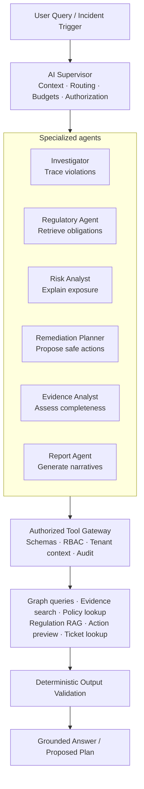

## **AI agents and their tools**

| Agent               | Authorized tools                                        |
| ------------------- | ------------------------------------------------------- |
| Investigation agent | Graph queries, incident search, observation lookup      |
| Regulatory agent    | Regulation retrieval, approved obligation lookup        |
| Risk agent          | Risk calculator, asset criticality, coverage analysis   |
| Remediation planner | Action catalog, impact simulation, plan preview         |
| Evidence agent      | Evidence lookup, signature validation results           |
| Reporting agent     | Control results, incident summaries, approved templates |

### **Example investigation**

A compliance officer asks:

> Why does a Marketing employee still have access to customer KYC data?

The AI investigator retrieves the employee's verified identity, HR history, group memberships, AWS permissions, database grants, applicable policies and approved exceptions.

It returns a structured response containing findings, evidence references, access paths, uncertainty and proposed remediation.

### **AI security requirements**

Retrieved documents, ticket descriptions, code and connector responses must be treated as untrusted data because they may contain prompt-injection instructions.

The model must not receive production credentials, unrestricted SQL execution, arbitrary shell access or direct permission to perform write operations.

Every tool invocation must be independently authorized against the requesting user's tenant and permissions.

# **14. Remediation orchestration architecture**

This module transforms a compliance finding into a safe, recoverable corrective workflow.

Use Temporal for workflows that require human approval, external API calls, retries and post-execution verification.

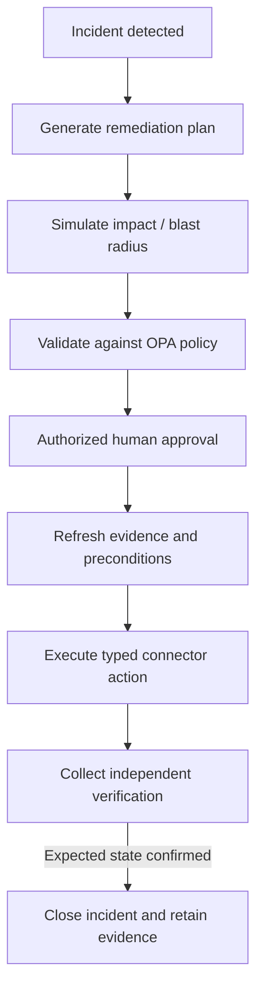

## **Action catalog**

The system should only execute predefined, typed operations.

```
type RemediationAction =
  | RemoveGroupMembership
  | RevokeDatabaseGrant
  | DisableIdentity
  | RevokeApplicationAssignment
  | RevokeSession
  | EnableResourceEncryption
  | RestrictPublicResource
  | CreateRemediationTicket;
```

### **Example approved action**

```
{
  "action_id": "action_001",
  "type": "revoke_database_grant",
  "tenant_id": "tenant_001",
  "connector_id": "postgres_prod",
  "target": {
    "principal": "rahul_rw",
    "database": "customer_data",
    "schema": "kyc",
    "privilege": "SELECT"
  },
  "preconditions": {
    "identity_mapping_verified": true,
    "policy_version": "1.4.0",
    "expected_state_hash": "sha256:..."
  },
  "approval_id": "approval_001",
  "idempotency_key": "remediation_001_step_01"
}
```

### **Workflow implementation concept**

```
async function remediationWorkflow(planId: string) {
  const plan = await loadPlan(planId);

  await validatePlan(plan);

  await waitForApproval(plan.id);

  await revalidateApproval(plan.id);

  await refreshPreconditions(plan);

  for (const action of plan.actions) {
    await executeAuthorizedAction(action);

    await reconcileActionOutcome(action);
  }

  const verification =
    await independentlyVerify(plan);

  if (!verification.complete) {
    await escalateForReview(plan.id);
    return;
  }

  await finalizeEvidence(plan.id);
  await resolveIncident(plan.incidentId);
}
```

This is conceptual workflow pseudocode. In Temporal, external I/O belongs inside Activities, and workflow code must remain deterministic.

## **Failure handling**

| Failure                           | System behavior                              |
| --------------------------------- | -------------------------------------------- |
| Approval expires                  | Request new approval                         |
| Identity or resource changes      | Invalidate existing plan                     |
| Connector unavailable             | Retry with bounded backoff                   |
| API response lost                 | Reconcile actual target state                |
| Partial execution                 | Preserve completed steps and escalate        |
| Alternative access path remains   | Keep incident open                           |
| Verification unavailable          | Mark pending verification                    |
| Remediation harms required access | Escalate and use approved recovery procedure |

Rollback is not always safe. Automatically restoring an unauthorized entitlement could recreate the original security violation.

# **15. Complete end-to-end use case**

## **Employee offboarding compliance failure**

Consider an employee who has been terminated, but still retains access to enterprise systems.

### **Compliance incident lifecycle**

This illustrative simulation follows all six stages of the offboarding workflow. The same four modeled access paths remain through approval.

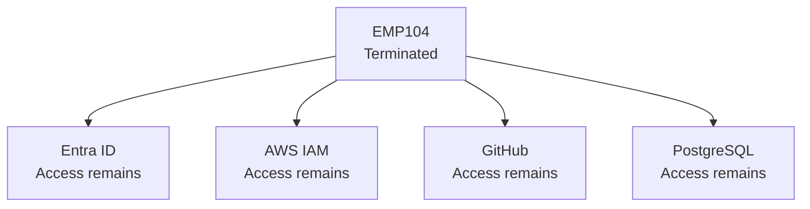

| Step | Stage | Incident status | What happens | Remaining modeled paths | Revoked paths |
| --- | --- | --- | --- | ---: | ---: |
| 1 of 6 | HR termination | Detected | HRMS reports that employee EMP104 has been terminated. | 4 | 0 |
| 2 of 6 | Cross-system discovery | Violation established | ComplyOS identifies four residual access paths using verified identity mappings. | 4 | 0 |
| 3 of 6 | AI investigation | Investigation complete | The investigator explains the access paths and links them to the approved offboarding control. | 4 | 0 |
| 4 of 6 | Approval | Approved | The authorized security officer approves a scoped revocation plan. | 4 | 0 |
| 5 of 6 | Remediation | Partially remediated | Entra ID, AWS IAM and GitHub access are revoked. The PostgreSQL grant remains because its connector is unavailable. | 1 | 3 |
| 6 of 6 | Retry and verification | Verified | The retry revokes the PostgreSQL grant. Independent verification checks all four modeled paths and confirms that access has been revoked. | 0 | 4 |

#### Stage 5 — Partial remediation

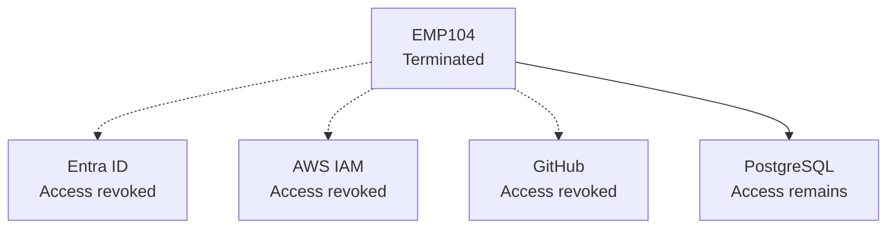

#### Stage 6 — Retry and verification

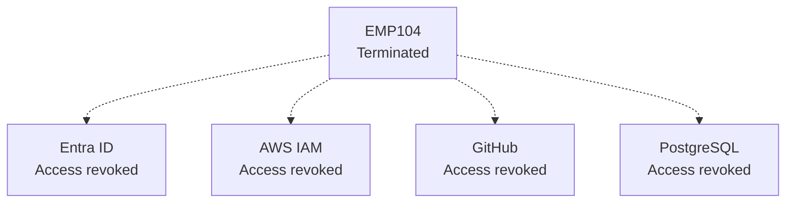

This is the flagship workflow I would implement first. It demonstrates every major component of your architecture without requiring hundreds of integrations.

# **16. Database architecture**

Use PostgreSQL as the primary source of truth, with separate logical schemas for different domains.

| Schema         | Tables                                                  |
| -------------- | ------------------------------------------------------- |
| `platform`     | tenants, users, roles, permissions, memberships         |
| `integration`  | connectors, credentials_refs, sync_jobs, checkpoints    |
| `fleet`        | agents, certificates, enrollments, heartbeats, releases |
| `inventory`    | entities, relationships, identity_mappings              |
| `governance`   | regulations, clauses, obligations, controls, policies   |
| `evaluation`   | observations, evaluation_runs, findings, exceptions     |
| `incident`     | incidents, incident_findings, assignments, comments     |
| `workflow`     | plans, approvals, actions, executions, verifications    |
| `evidence`     | objects, signatures, manifests, retention_policies      |
| `audit`        | audit_events, outbox_events                             |
| `intelligence` | documents, embeddings, investigations, model_runs       |

## **Core entity relationship diagram**

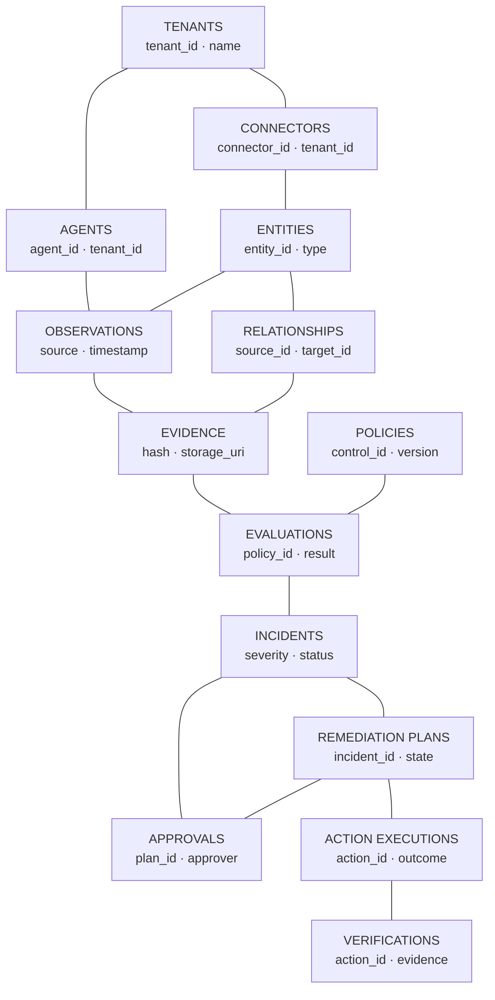

Simplified logical ERD; production schema requires additional association tables and tenant-aware foreign keys.

## **Storage responsibilities**

| Storage              | Data                                                                      |
| -------------------- | ------------------------------------------------------------------------- |
| PostgreSQL           | Transactional records, graph relationships, policies, workflow references |
| Object storage       | Raw observations, reports, signed evidence manifests                      |
| pgvector             | Regulation and approved policy embeddings                                 |
| Redis                | Short-lived caches, rate limits, temporary coordination                   |
| Temporal persistence | Durable workflow execution history                                        |
| NATS JetStream       | Event delivery and replay within configured retention                     |

### **Multi-tenant isolation**

Every customer-owned record should include `tenant_id`.

Use PostgreSQL row-level security, tenant-aware composite foreign keys, application authorization, tenant-scoped object-storage access and isolation tests.

For large regulated enterprises, offer dedicated databases or fully isolated deployments.

# **17. API architecture**

All APIs should be versioned and documented through OpenAPI.

| Domain        | Endpoint                         | Method |
| ------------- | -------------------------------- | ------ |
| Tenant        | `/v1/tenants`                    | POST   |
| Integrations  | `/v1/connectors`                 | POST   |
| Integrations  | `/v1/connectors/{id}/sync`       | POST   |
| Agents        | `/v1/agents/enroll`              | POST   |
| Agents        | `/v1/agents/{id}/heartbeat`      | POST   |
| Evidence      | `/v1/observations/batch`         | POST   |
| Inventory     | `/v1/entities`                   | GET    |
| Graph         | `/v1/graph/access-paths`         | POST   |
| Graph         | `/v1/graph/impact`               | POST   |
| Regulations   | `/v1/regulations`                | GET    |
| Policies      | `/v1/policies`                   | POST   |
| Policies      | `/v1/policies/{id}/evaluate`     | POST   |
| Incidents     | `/v1/incidents`                  | GET    |
| Investigation | `/v1/incidents/{id}/investigate` | POST   |
| Remediation   | `/v1/incidents/{id}/plans`       | POST   |
| Approval      | `/v1/plans/{id}/approve`         | POST   |
| Execution     | `/v1/plans/{id}/execute`         | POST   |
| Verification  | `/v1/plans/{id}/verify`          | POST   |
| Reporting     | `/v1/reports`                    | POST   |
| Replay        | `/v1/incidents/{id}/timeline`    | GET    |
| Copilot       | `/v1/copilot/chat`               | POST   |

Use Server-Sent Events for streaming AI responses, live scan progress and remediation workflow updates.

Agent-to-gateway communication can use Protobuf contracts.

```
service AgentGateway {
  rpc Enroll(EnrollRequest)
      returns (EnrollResponse);

  rpc Heartbeat(HeartbeatRequest)
      returns (HeartbeatResponse);

  rpc UploadObservations(stream ObservationBatch)
      returns (UploadReceipt);

  rpc PollJobs(JobRequest)
      returns (stream CollectionJob);

  rpc SubmitJobResult(JobResult)
      returns (JobReceipt);
}
```

Enrollment must use a separately protected bootstrap endpoint before the agent has its production certificate.

# **18. Frontend application architecture**

The application should have dedicated workspaces for different enterprise personas.

### **Compliance overview**

Illustrative enterprise workspace.

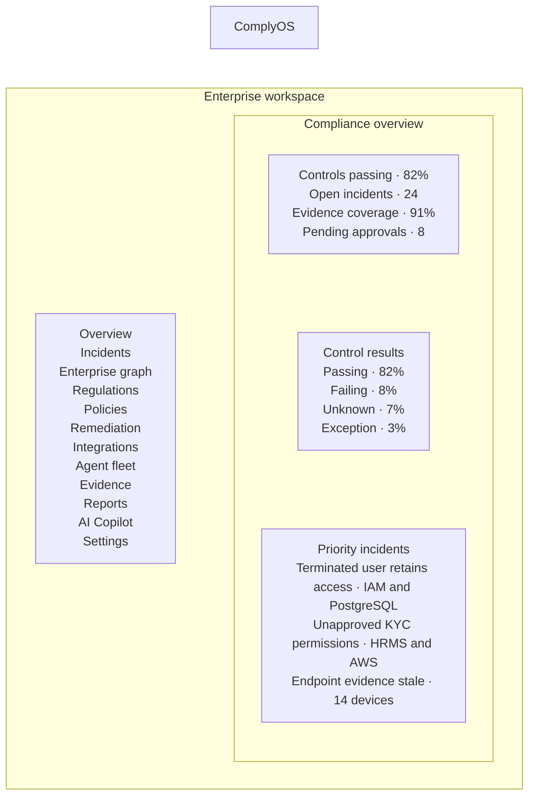

## **User personas and authorization**

| Persona                  | Responsibilities                          |
| ------------------------ | ----------------------------------------- |
| Enterprise administrator | Tenant configuration and integrations     |
| CISO                     | Enterprise security posture and risk      |
| Compliance officer       | Regulatory controls and applicability     |
| Security analyst         | Investigations and incident management    |
| Data owner               | Dataset access reviews                    |
| IT administrator         | Agent management and remediation          |
| Approver                 | Authorization of specific changes         |
| Auditor                  | Read-only evidence and historical reports |
| Executive                | Aggregated risk and compliance trends     |

Use separation of duties so that an investigator cannot automatically approve and execute their own high-risk remediation plan.

# **19. Evidence vault and audit architecture**

The evidence vault must be designed for trustworthy historical reconstruction.

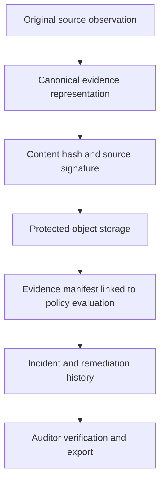

### **Evidence manifest**

```
{
  "evidence_id": "ev_001",
  "tenant_id": "tenant_001",
  "source": "aws-iam",
  "collector_version": "1.2.0",
  "observed_at": "2026-11-25T07:00:00Z",
  "received_at": "2026-11-25T07:00:02Z",
  "content_hash": "sha256:...",
  "signature": "...",
  "signing_key_id": "key_001",
  "storage_uri": "s3://evidence/tenant_001/ev_001",
  "policy_version": "1.4.0",
  "retention_policy": "tenant-approved-policy"
}
```

Use object retention, encryption, protected signing keys, access logs and periodic integrity checks.

Support OSCAL-compatible exports where appropriate, alongside JSON, CSV and PDF reports.

Retention policies must account for both audit obligations and applicable data-minimization and deletion requirements.

# **20. Security architecture**

Security must be a first-class architectural layer because ComplyOS itself will hold highly sensitive enterprise information.

| Security layer        | Implementation                                 |
| --------------------- | ---------------------------------------------- |
| User authentication   | Enterprise OIDC/SAML and MFA                   |
| Authorization         | RBAC with resource-level policies              |
| Tenant isolation      | PostgreSQL RLS and scoped storage              |
| Agent authentication  | Per-agent certificates and mTLS                |
| Service identity      | Workload identities                            |
| Secret management     | Vault or managed secrets service               |
| Encryption in transit | TLS                                            |
| Encryption at rest    | KMS-managed encryption                         |
| Evidence integrity    | Signatures, hashes, protected retention        |
| Network isolation     | Private subnets and restrictive egress         |
| API security          | Validation, quotas, rate limits                |
| AI security           | Tool allowlists and prompt-injection defenses  |
| Remediation security  | Approval binding and scoped execution          |
| Supply-chain security | Signed packages, SBOMs and dependency scanning |
| Operational security  | Audit logs and privileged-access monitoring    |

### **Trust boundaries**

The agent, enterprise relay, SaaS backend, AI model provider, connector provider and customer administrator must all be treated as separate trust boundaries.

Even an enrolled agent can be compromised. A valid signature proves that a registered key signed the evidence, not that every collected fact is necessarily true.

# **21. Deployment architecture**

## **21.1 SaaS deployment on AWS**

S3, Bedrock and other managed services are accessed through their supported service endpoints; the diagram groups them logically rather than implying they all run inside private subnets.

## **21.2 Deployment editions**

| Component     | Developer            | SaaS              | Enterprise self-hosted  |
| ------------- | -------------------- | ----------------- | ----------------------- |
| Frontend      | Local                | Managed           | Customer cluster        |
| Backend       | Docker               | Managed           | Customer cluster        |
| Database      | PostgreSQL container | RDS               | Customer PostgreSQL     |
| Evidence      | MinIO                | S3                | Customer object storage |
| Identity      | Local development    | OIDC              | Enterprise SSO          |
| AI            | Optional API         | Approved provider | Private model/provider  |
| Agents        | Local                | Remote            | Internal                |
| Orchestration | Compose              | ECS/EKS           | Kubernetes/OpenShift    |

An air-gapped edition would additionally require offline software updates, offline regulatory pack imports and a local model or deterministic AI-disabled operation.

# **22. Scalability and performance design**

Assume a medium-to-large enterprise deployment with the following illustrative workload.

## **Enterprise ingestion capacity calculator**

Managed endpoints

Facts per scan

Scan interval (minutes)

Average bytes per fact

Observations per day

# **2,88,00,000**

Average observations/sec

# **333.3**

Raw data per day

# **14.40 GB**

Raw data per 30 days

# **432.0 GB**

Estimates before compression, change detection, indexing, replication, protocol overhead and other enterprise integrations.

### **Scaling strategies**

| Bottleneck                      | Solution                                               |
| ------------------------------- | ------------------------------------------------------ |
| Agent ingestion bursts          | Batch uploads, randomized scheduling, backpressure     |
| Repeated unchanged observations | Change detection and periodic full snapshots           |
| Large observation tables        | Time-based partitioning                                |
| Expensive graph queries         | Indexed edges, bounded traversal, cached projections   |
| Connector rate limits           | Per-provider concurrency budgets                       |
| Policy evaluation load          | Evaluate only affected controls                        |
| Large evidence payloads         | Object storage and compressed batches                  |
| LLM costs                       | Trigger AI only for investigations requiring reasoning |
| Noisy incidents                 | Deduplication and business-level correlation           |
| Workflow failures               | Durable execution and reconciliation                   |

### **Proposed initial service objectives**

| Metric                      | Target                                 |
| --------------------------- | -------------------------------------- |
| Control plane availability  | 99.9%                                  |
| Standard API latency        | p95 under 300 ms                       |
| Observation acknowledgement | p95 under 2 seconds                    |
| Event-driven detection      | Under 60 seconds after valid ingestion |
| Scheduled posture freshness | Within configured collection window    |
| Recovery point objective    | 5 minutes                              |
| Recovery time objective     | 1 hour                                 |

These are proposed engineering targets that must be validated through load testing and disaster-recovery exercises.

# **23. Observability architecture**

ComplyOS needs visibility into its own monitoring coverage. A compliance platform that silently stops collecting evidence is itself an operational risk.

Use OpenTelemetry to propagate correlation IDs across API requests, connector jobs, events, policy evaluations and remediation workflows.

| Metric                          | Purpose                         |
| ------------------------------- | ------------------------------- |
| `agent_heartbeat_age_seconds`   | Detect offline agents           |
| `connector_sync_failures_total` | Detect integration failures     |
| `observation_ingestion_rate`    | Measure collection throughput   |
| `graph_projection_lag_seconds`  | Detect stale graph state        |
| `policy_evaluation_duration`    | Monitor evaluation performance  |
| `incident_detection_latency`    | Measure detection effectiveness |
| `remediation_failure_total`     | Monitor execution reliability   |
| `verification_pending_total`    | Detect unresolved changes       |
| `evidence_integrity_failures`   | Detect integrity issues         |
| `llm_tokens_total`              | Track AI costs                  |
| `llm_grounding_failure_total`   | Monitor AI output quality       |

Every tenant should have a coverage dashboard showing connected systems, permissions granted to connectors, last successful scans and known blind spots.

# **24. Final monorepo structure**

```
complyos/
│
├── apps/
│   ├── dashboard/
│   ├── api/
│   ├── agent-gateway/
│   └── auditor-portal/
│
├── packages/
│   ├── contracts/
│   ├── database/
│   ├── auth/
│   ├── tenant/
│   ├── integrations/
│   ├── normalization/
│   ├── identity-resolution/
│   ├── compliance-graph/
│   ├── data-classification/
│   ├── regulatory-intelligence/
│   ├── policy-engine/
│   ├── incident-engine/
│   ├── remediation-engine/
│   ├── evidence-engine/
│   ├── reporting/
│   ├── ai-engine/
│   └── observability/
│
├── workers/
│   ├── collection/
│   ├── normalization/
│   ├── graph-projection/
│   ├── policy-evaluation/
│   ├── incident-correlation/
│   ├── remediation/
│   ├── verification/
│   └── regulatory-ingestion/
│
├── agents/
│   ├── endpoint/
│   ├── relay/
│   ├── common/
│   ├── installers/
│   └── go.work
│
├── connectors/
│   ├── aws/
│   ├── azure/
│   ├── gcp/
│   ├── postgres/
│   ├── github/
│   ├── entra/
│   ├── okta/
│   ├── saviynt/
│   ├── darwinbox/
│   ├── intune/
│   └── generic/
│
├── policies/
│   ├── rego/
│   ├── internal-controls/
│   ├── regulatory-packs/
│   │   ├── dpdp/
│   │   ├── rbi/
│   │   ├── sebi/
│   │   ├── soc2/
│   │   └── iso27001/
│   └── tests/
│
├── proto/
│   ├── agent.proto
│   ├── observation.proto
│   ├── job.proto
│   └── evidence.proto
│
├── infrastructure/
│   ├── terraform/
│   ├── helm/
│   ├── docker/
│   └── monitoring/
│
├── tests/
│   ├── unit/
│   ├── integration/
│   ├── connector-contract/
│   ├── tenant-isolation/
│   ├── security/
│   ├── load/
│   ├── ai-evaluation/
│   └── end-to-end/
│
├── examples/
│   ├── employee-offboarding/
│   ├── employee-transfer/
│   └── expo/
│
├── docs/
├── compose.yaml
├── pnpm-workspace.yaml
├── turbo.json
└── README.md
```

# **25. Implementation plan**

Do not attempt to implement the entire target architecture simultaneously. Build vertical slices that work end to end.

## **24-week engineering roadmap**

Illustrative overlapping roadmap. A part-time solo implementation may require longer.

## **Phase 1 — Core platform**

Weeks 1–4: migrate existing business logic into TypeScript modules, introduce Fastify, normalized PostgreSQL, tenant isolation, database migrations and enterprise authentication.

## **Phase 2 — Enterprise graph**

Weeks 4–7: implement entities, relationships, temporal history, identity resolution and generic access-path queries. Remove hardcoded employee and dataset logic from `engine.mjs`.

## **Phase 3 — Collection infrastructure**

Weeks 6–12: implement connector SDK, AWS, PostgreSQL, GitHub and HR integration. Build the Go enterprise relay with secure enrollment and offline buffering.

## **Phase 4 — Compliance detection**

Weeks 10–13: implement policy registry, OPA evaluation, applicability, exceptions, incident correlation and coverage tracking.

## **Phase 5 — Safe remediation**

Weeks 13–17: introduce Temporal, action catalog, impact preview, human approvals, scoped execution and independent verification.

## **Phase 6 — Evidence and intelligence**

Weeks 15–21: implement evidence storage, signatures, historical replay, regulatory ingestion, RAG and AI investigation.

## **Phase 7 — Enterprise pilot**

Weeks 21–24: perform tenant-isolation testing, security reviews, load testing, failure injection and read-only deployment in an authorized enterprise environment.

# **26. Minimum viable enterprise product**

The first release should not attempt to compete with every feature of Vanta, Drata, Wiz or Saviynt.

## **ComplyOS V1**

Identity-to-data regulatory control assurance

**Enterprise graph**

Identity and sensitive data relationships

**Private relay**

Secure enterprise system connectivity

**Five connectors**

HR, Entra, AWS, PostgreSQL, GitHub

**Incident engine**

Offboarding and excessive access

**AI investigator**

Evidence-grounded root cause analysis

**Safe remediation**

Approval, execution and verification

**Regulatory packs**

Reviewed DPDP and internal controls

**Evidence vault**

Historical audit reconstruction

# **27. Architecture decisions I would finalize now**

| Decision                      | Choice                                                |
| ----------------------------- | ----------------------------------------------------- |
| Rewrite existing application? | No, incremental migration                             |
| Microservices from day one?   | No, modular monolith and workers                      |
| Backend language              | TypeScript                                            |
| Agent language                | Go                                                    |
| Graph storage                 | PostgreSQL initially                                  |
| Policy engine                 | OPA                                                   |
| Workflow engine               | Temporal                                              |
| Event streaming               | NATS after transactional outbox                       |
| AI framework                  | Structured tools first, LangGraph where justified     |
| Deployment model              | Hybrid SaaS and self-hosted                           |
| Initial industry              | BFSI                                                  |
| Initial use case              | Identity-to-sensitive-data access compliance          |
| Default remediation           | Human-approved                                        |
| Default collection            | Read-only                                             |
| Product differentiator        | Independently verified regulatory control remediation |

The architecture choices above are my proposed design decisions, not requirements you have explicitly finalized. They are based on the earlier repository inspection; I have not implemented, benchmarked or security-tested this target architecture.

The most valuable part of ComplyOS will not be its chatbot, dashboard or individual scanners. It will be the intelligence connecting all of them:

**Regulation → Internal control → Employee → Identity → Permission → Sensitive data → Violation → Remediation → Verified evidence.**

That complete chain is what I would make the foundation of the application.