# ComplyOS 2.0 architecture visual gallery

These static illustrations recreate the supplied architecture and product references. The design document contains the editable Mermaid diagrams, calculation formulas and implementation details. [System design](complyos-2-system-design.md)

- [1. High-level system architecture](#1-high-level-system-architecture)
- [4. Enterprise onboarding architecture](#4-enterprise-onboarding-architecture)
- [5. Agent and collector architecture](#5-agent-and-collector-architecture)
- [7. Data ingestion and event-driven architecture](#7-data-ingestion-and-event-driven-architecture)
- [8. Compliance Graph](#8-compliance-graph)
- [9. Cross-system identity resolution engine](#9-cross-system-identity-resolution-engine)
- [10. Regulatory intelligence engine](#10-regulatory-intelligence-engine)
- [13. Agentic AI architecture](#13-agentic-ai-architecture)
- [14. Remediation orchestration architecture](#14-remediation-orchestration-architecture)
- [15. Complete end-to-end use case](#15-complete-end-to-end-use-case)
- [16. Database architecture](#16-database-architecture)
- [18. Frontend application architecture](#18-frontend-application-architecture)
- [19. Evidence vault and audit architecture](#19-evidence-vault-and-audit-architecture)
- [21. Deployment architecture](#21-deployment-architecture)
- [22. Scalability and performance design](#22-scalability-and-performance-design)
- [25. Implementation plan](#25-implementation-plan)
- [26. Minimum viable enterprise product](#26-minimum-viable-enterprise-product)

## 1. High-level system architecture

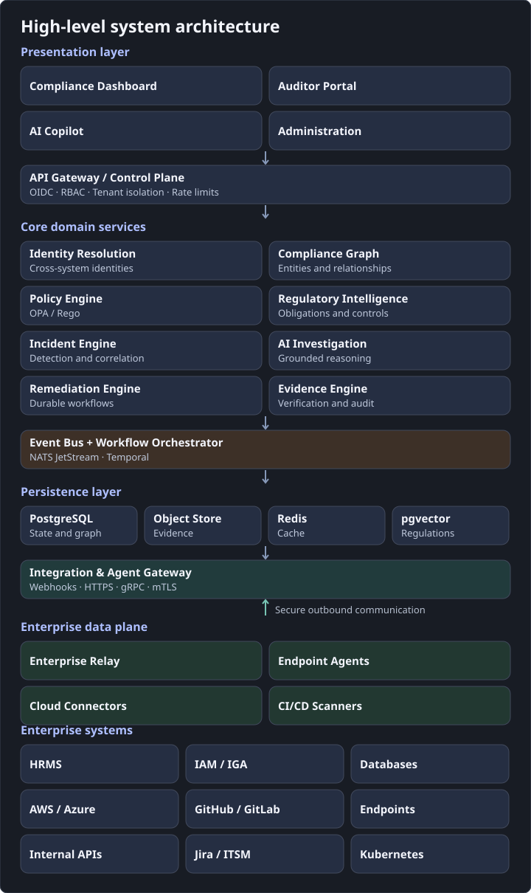

## 4. Enterprise onboarding architecture

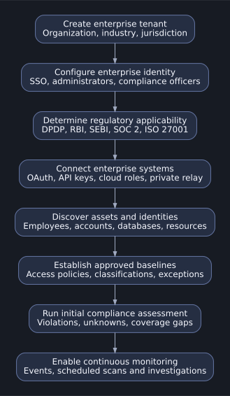

## 5. Agent and collector architecture

### 5.1 Internal Go agent architecture

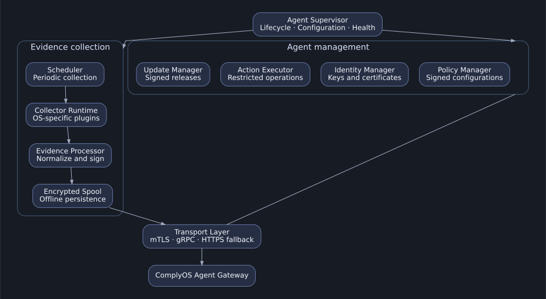

### 5.2 Enterprise relay

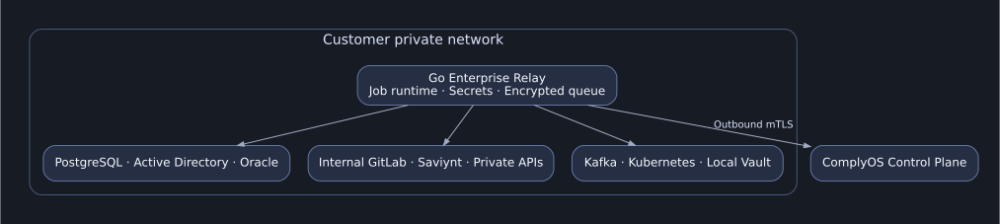

## 7. Data ingestion and event-driven architecture

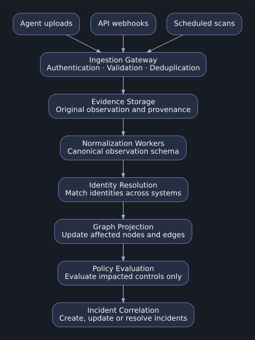

## 8. Compliance Graph

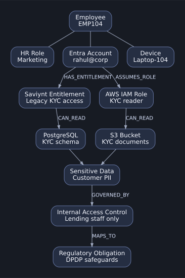

## 9. Cross-system identity resolution engine

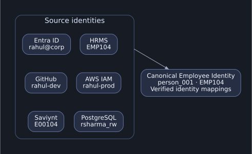

## 10. Regulatory intelligence engine

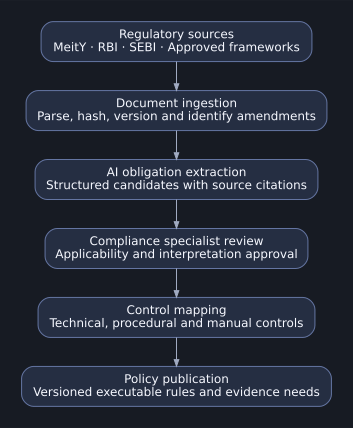

## 13. Agentic AI architecture

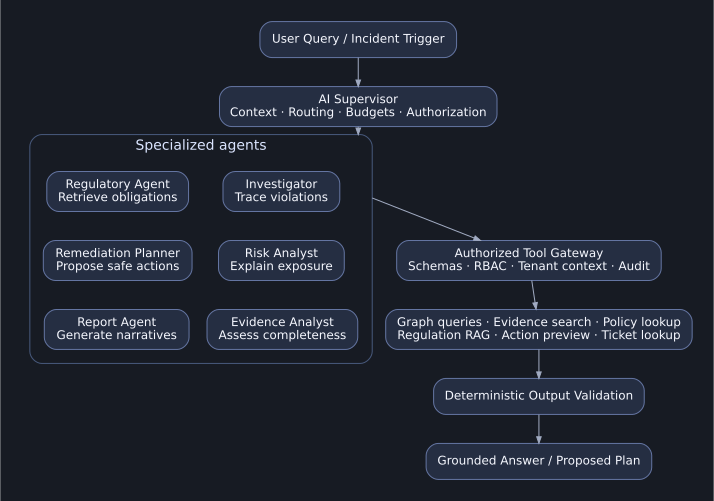

## 14. Remediation orchestration architecture

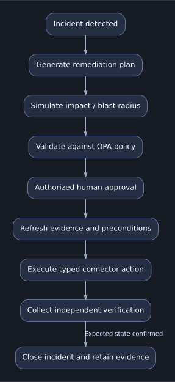

## 15. Complete end-to-end use case

### Step 1 of 6 — HR termination

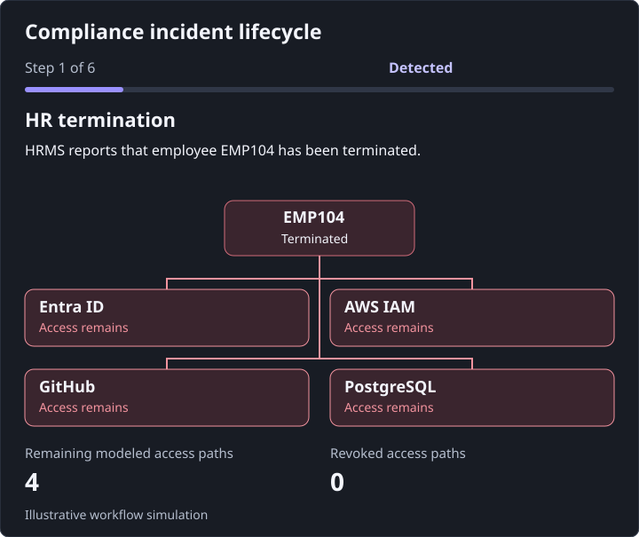

### Step 2 of 6 — Cross-system discovery

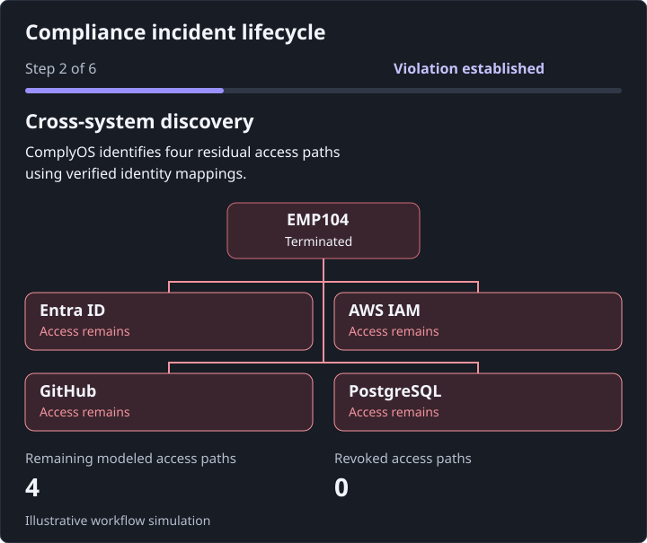

### Step 3 of 6 — AI investigation

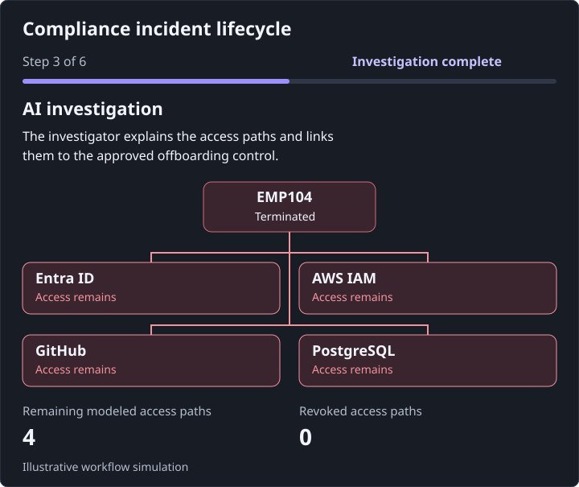

### Step 4 of 6 — Approval

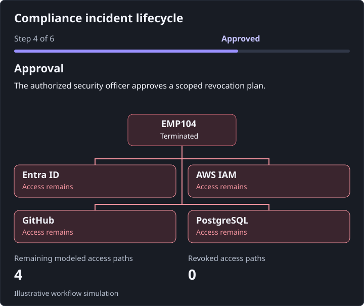

### Step 5 of 6 — Remediation

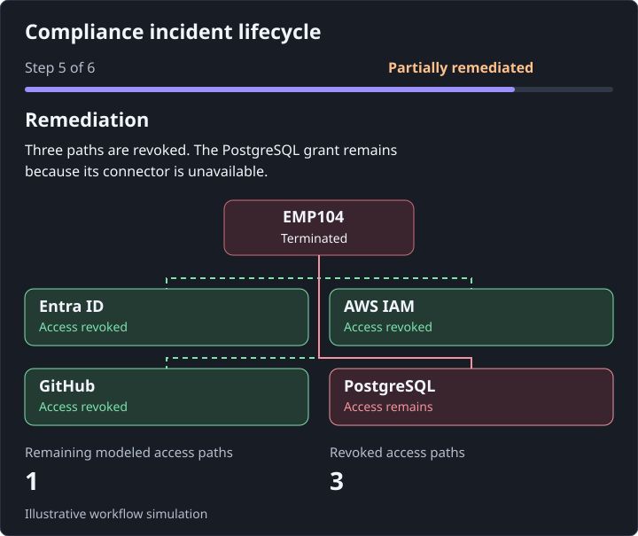

### Step 6 of 6 — Retry and verification

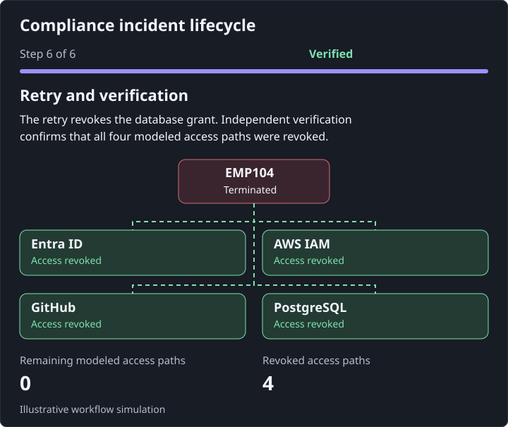

## 16. Database architecture

### Core entity relationship diagram

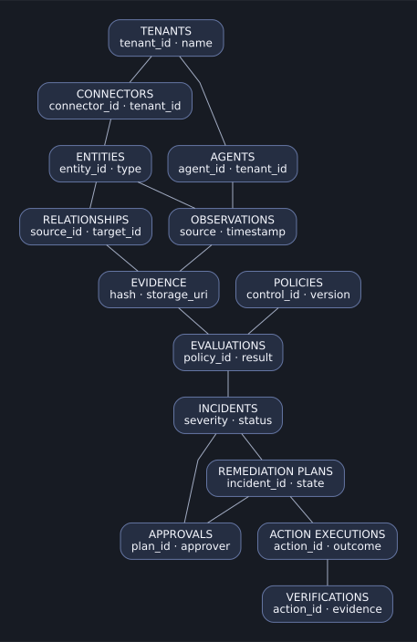

## 18. Frontend application architecture

### Compliance overview

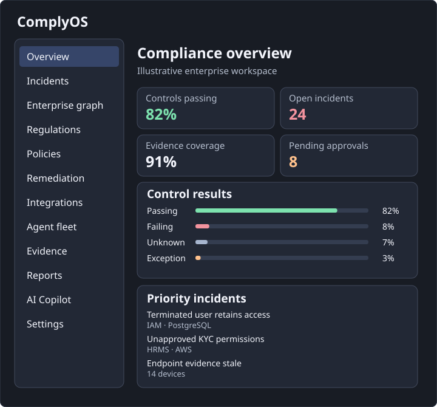

## 19. Evidence vault and audit architecture

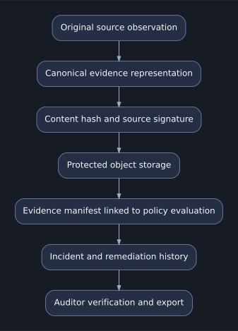

## 21. Deployment architecture

### 21.1 SaaS deployment on AWS

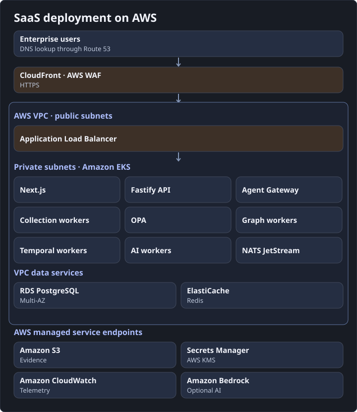

## 22. Scalability and performance design

### Enterprise ingestion capacity example

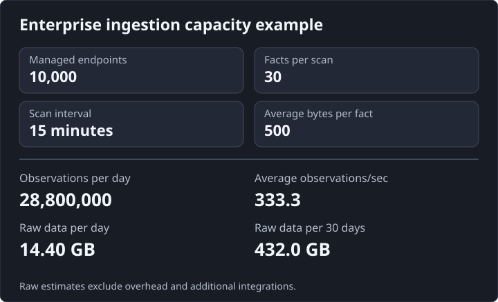

## 25. Implementation plan

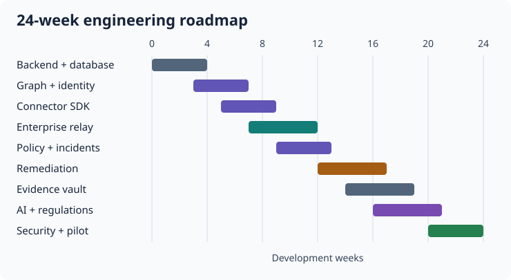

## 26. Minimum viable enterprise product

### ComplyOS V1 scope

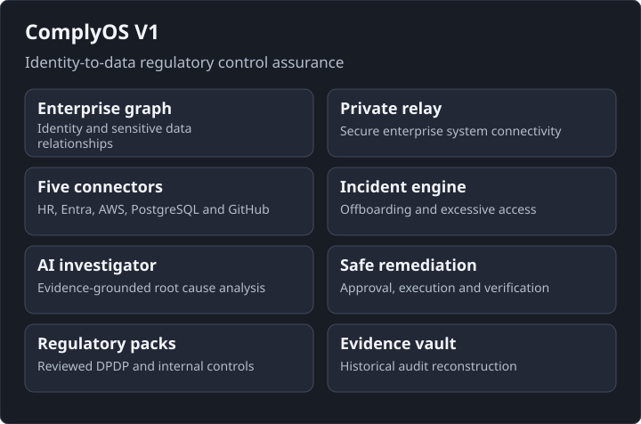
